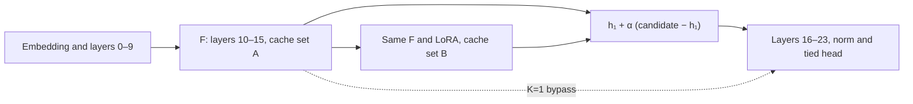

# LoopQwen-MLX

A local MLX research implementation of shared recurrent depth in the official Qwen3.5-0.8B-Base text decoder. Layers 10–15 run twice at K=2. The 30 execution sites reuse 752,393,024 pretrained text parameters. Training adds 1,336,320 shared LoRA parameters to the six-layer span. Each execution site owns its own attention or Gated DeltaNet state.

## Does the second pass earn its cost?

The development study compares dense adaptation, direct recurrence and a near-identity refinement at the same 100,068 supervised tokens. A single learned sigmoid controls the extra pass. Every recurrent checkpoint also runs at true K=1 so its adapters can be evaluated without the extra computation. The primary outcome is greedy final-answer accuracy on traced problems. Exact procedural certificates, independent language retention and measured latency provide additional evidence. [Registration and reproduction](docs/EXPERIMENT_REGISTRY.md) · [Architecture](docs/PHASE3_ARCHITECTURE.md)

At 250,031 matched supervised tokens, the learned-gate checkpoint solved **61/150 fresh ID and 47/150 fresh OOD development problems**. Bypassing its second pass produced the same two totals. On each split the extra pass fixed one answer and broke one. The matched dense checkpoint scored 58/150 and 41/150. This seed suggests a possible training-time benefit. It gave us no net final-answer gain from running the extra six layers at inference. The registered promotion rule kept the three-seed confirmatory test sealed. [Dense adapter](adapters/phase3/p3_dense_250k) · [Learned refinement adapter](adapters/phase3/p3_learn1_250k) · [Development results](docs/PHASE3_RESULTS.md)


## Run the trained model

Use a native arm64 Mac with the locked MLX environment. From the repository root:

```sh
./scripts/bootstrap.sh
source .venv/bin/activate
python -m loopqwen download
python -m loopqwen generate --checkpoint adapters/phase3/p3_learn1_250k --prompt 'Evaluate ((8 + 4) * 3 - 5).
Show your steps. End with Final answer: <number>.
Solution:' --max-tokens 96
```

Add `--passes 1` to the generation command to run the same adapters at their true bypass depth. Use `adapters/phase3/p3_dense_250k` to try the matched dense model.

## Reproduce the study

The [experiment registry](docs/EXPERIMENT_REGISTRY.md) lists the ordered commands from data preparation through training, evaluation and archival. The [training guide](docs/TRAINING.md) explains checkpoints and update budgets. The [performance report](docs/PHASE3_OPTIMIZATIONS.md) records memory, throughput and deployment measurements on the 18 GiB M3 Pro.

## Shared block and independent caches



## Historical experiments

The 1,000-update loop answered 59/110 held-out procedural questions correctly. The same checkpoint at K=1 answered 55/110, and the matched dense twin reached 65/110. The experiment compares the untouched base, the untrained loop and two matched trained twins. Its primary outcomes are held-out answer loss and greedy numeric accuracy. Prose retention, variable depth and a longer-output dense control are also measured. [Experimental results](docs/RESULTS.md)

## Try the trained loop

The repository includes small inference adapters for both training pairs. From a clone, run

```sh
./scripts/bootstrap.sh
source .venv/bin/activate
python -m loopqwen download
python -m loopqwen generate --checkpoint adapters/extended_loop --prompt 'Question: 17 × 23
Answer:' --max-tokens 16
```

## Reproduce the pilot

Use a native arm64 macOS Python environment and run these commands from the repository root. Bootstrap uses uv when available and otherwise creates a Python 3.12 venv with constraints from the lockfile. The default dataset builder downloads small pinned public math splits. The model download uses the official Base checkpoint.

```sh
./scripts/bootstrap.sh
source .venv/bin/activate
python -m loopqwen download
python -m loopqwen baseline
python -m loopqwen probe --start-layer 10 --num-layers 6 --passes 2
python -m loopqwen cache-check
python -m loopqwen gradient-check
python -m loopqwen gdn-check
./scripts/run_pilot.sh
python -m loopqwen benchmark --config configs/benchmark.yaml
python -m pytest -q
python -m loopqwen export --checkpoint checkpoints/pilot_loop --output exports/loopqwen-0.8b
python -m loopqwen generate --checkpoint exports/loopqwen-0.8b --prompt 'What is 17 times 23?' --max-tokens 32
```

The pilot script builds data, trains both 12-update smoke runs, trains both 200-update pilots and runs evaluation. A completed run name reuses its latest checkpoint. A clean checkout reproduces training from the official weights. The full integration suite expects the completed pilot and its manifest.

## Individual commands

```sh
python -m loopqwen doctor
python -m loopqwen data --preset pilot
python -m loopqwen train --config configs/smoke.yaml --until 6
python -m loopqwen train --config configs/smoke.yaml
python -m loopqwen train --config configs/pilot_dense.yaml
python -m loopqwen train --config configs/pilot_loop.yaml
python -m loopqwen evaluate --experiment pilot
python -m loopqwen compare --experiment pilot
python -m loopqwen report --experiment pilot
python -m loopqwen generate --checkpoint checkpoints/pilot_loop --prompt 'Question: 17 × 23
Answer:' --max-tokens 16
```

The base model uses raw text. The adaptation examples use a question followed by a newline and `Answer:`. Generation is greedy, capped and EOS-aware. Adapter checkpoints require the pinned base snapshot. The BF16 merged export includes its own tokenizer and recurrent runtime, with a fresh-process check on every logit of the export verification prompt.

## Reproduce the extended comparison

The 1,000-update pair starts from the same pretrained base, using four documents per update and the existing pilot splits. In the activated environment, run the following commands after building the data.

```sh
python -m loopqwen train --config configs/extended_dense.yaml
python -m loopqwen train --config configs/extended_loop.yaml
python -m loopqwen evaluate --experiment extended
python -m loopqwen compare --experiment extended
python -m loopqwen export --checkpoint checkpoints/extended_loop --output exports/loopqwen-extended-0.8b
```

## Project files

| Path | Contents |
|---|---|
| `configs/` | Hardware presets, matched training runs, benchmark and evaluation settings |
| `loopqwen/looped_model.py` | Shared execution schedule, interpolation and tied output head |
| `loopqwen/recurrent_cache.py` | Independent execution-site caches |
| `loopqwen/kernels/gdn_backend.py` | Validated native training path and stock fallback |
| `loopqwen/training/` | Adapter placement, token-weighted loss, optimizer and trainer |
| `loopqwen/checkpoint.py`, `loopqwen/export.py` | Atomic resumable generations and merged export |
| `data/pilot/` | Local tokenized examples, split digests and source manifest |
| `checkpoints/<run>/latest.json` | Pointer to the most recent complete generation |
| `outputs/<experiment>/` | Each generated answer, decoding settings, scores and Markdown comparison |
| `docs/` | Measured results, implementation details and reproduction notes |

The code license is MIT. Official Qwen weights retain their own license, copied into merged exports. GSM8K and MATH source licenses are recorded beside the downloaded data. Full backbone weights, merged exports, local optimizer checkpoints and raw datasets stay outside Git. The four compact adapter bundles are included. [Architecture](docs/ARCHITECTURE.md) · [Training](docs/TRAINING.md) · [Metal benchmarks](docs/METAL_OPTIMIZATIONS.md) · [Troubleshooting](docs/TROUBLESHOOTING.md)

## Phase 2 recurrent-depth study

V2 uses 24,000 distinct procedural problems with verified derivations, a separate answer-only prompt, held-out difficulty regimes and independent prose retention data. The historical pilot and extended runs retain their original scoring protocols. The [registered design](docs/PHASE2_PLAN.md), [architecture audit](docs/PHASE2_ARCHITECTURE.md), [Metal investigation](docs/PHASE2_OPTIMIZATIONS.md) and [first V2 development comparison](docs/measurements/phase2/phase2_direct/comparison.md) describe the new study.

From the project root on native Apple Silicon:

```sh
uv sync --locked --group figures
.venv/bin/python -m loopqwen download
.venv/bin/python -m loopqwen data --preset v2
.venv/bin/python -m loopqwen train --config configs/phase2/p2_a_trace_dense.yaml
.venv/bin/python -m loopqwen train --config configs/phase2/p2_a_trace_loop.yaml
.venv/bin/python -m loopqwen compare --experiment phase2_direct
```

`scripts/run_phase2.sh` runs all registered controls, development selection, three confirmatory seeds and diagnostics sequentially. Use a separate checkout for an independent reproduction. In the original workspace, identical configurations resume using their saved optimizer and deterministic cursor. The `figures` dependency group supplies Matplotlib. Group-level evaluation requires every registered checkpoint to be complete. The comparison command can also read the archived table in a fresh clone.

For fast checks independent of model weights or Metal, use `python -m pytest -q tests/test_phase2.py -k 'numeric or gold_and_fingerprints'`. The remaining Phase 2 checks require the locked environment and built V2 corpus. The historical integration suite also requires the original pilot dataset and completed pilot checkpoints. The expensive three-seed experiment runs through the study script separately from pytest.

`python -m loopqwen resources` lists project processes, their parent PIDs, the current exclusive GPU lease, OS memory pressure and swap occupancy. A standalone model worker acquires the lease before loading weights. The study launcher runs one coordinator per checkout and forwards cancellation to its process group, allowing an active trainer to save at an update boundary. A lock file may remain on disk after exit. The resources command checks the kernel lock to determine whether a worker owns it.

The [completed three-seed Phase 2 report](docs/PHASE2_RESULTS.md) includes ID and OOD accuracy, uncertainty, measured compute controls, prose retention, export parity and memory measurements. The [seed-43 recurrent adapter](adapters/p2_confirm_43_loop) and its [matched dense twin](adapters/p2_confirm_43_dense) load directly with the generation CLI. Subsequent study reproductions write an independent archive under `outputs/phase2/reproduction/` once the original results have a checksum index.
