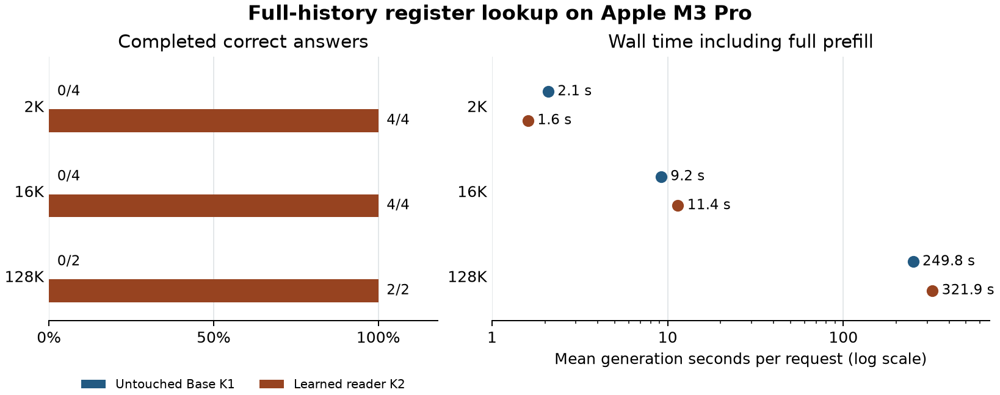
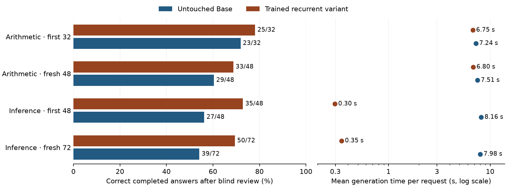
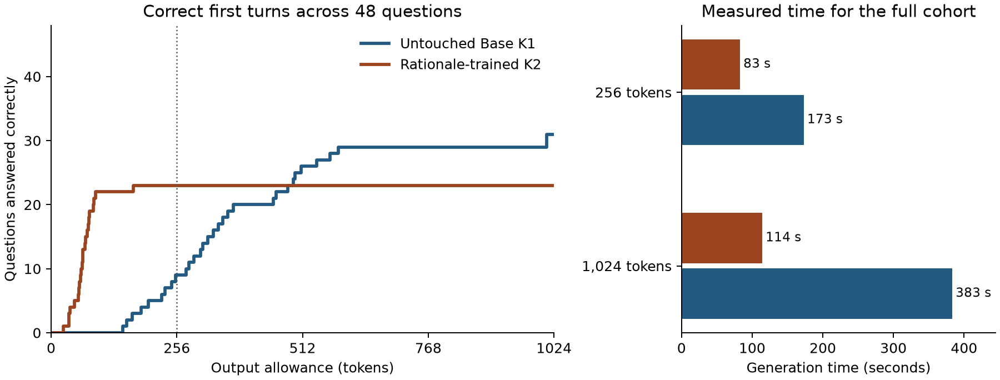
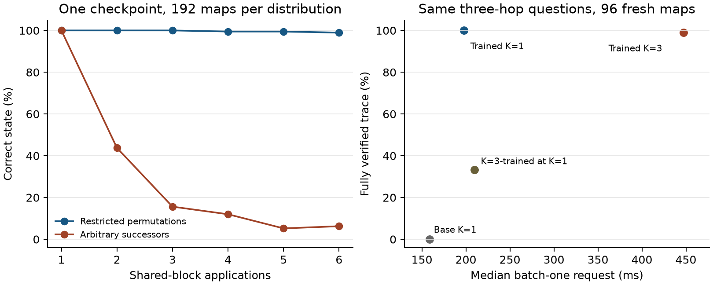
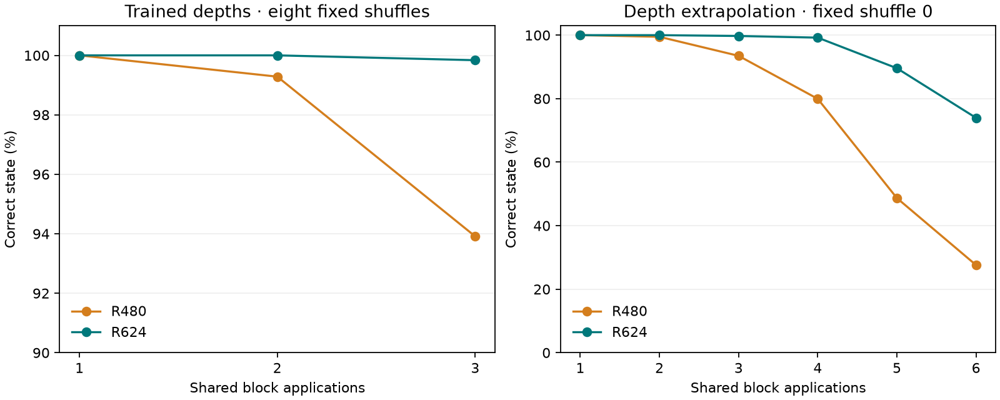
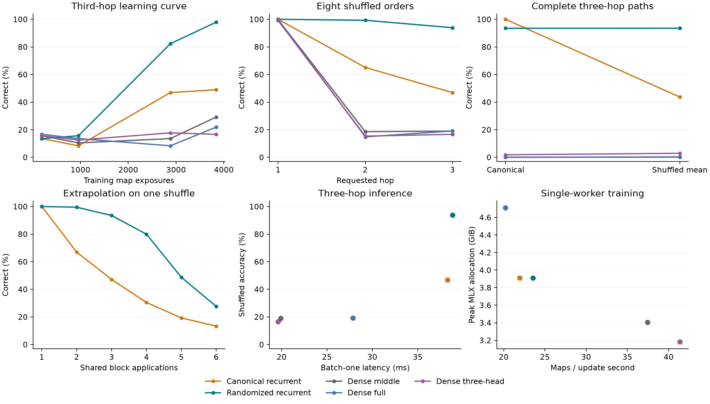
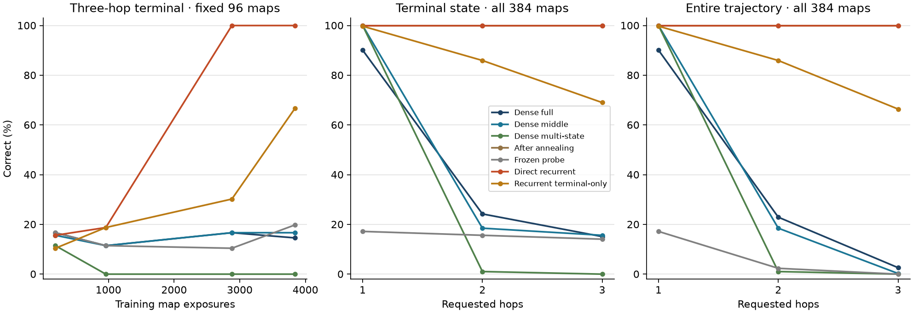
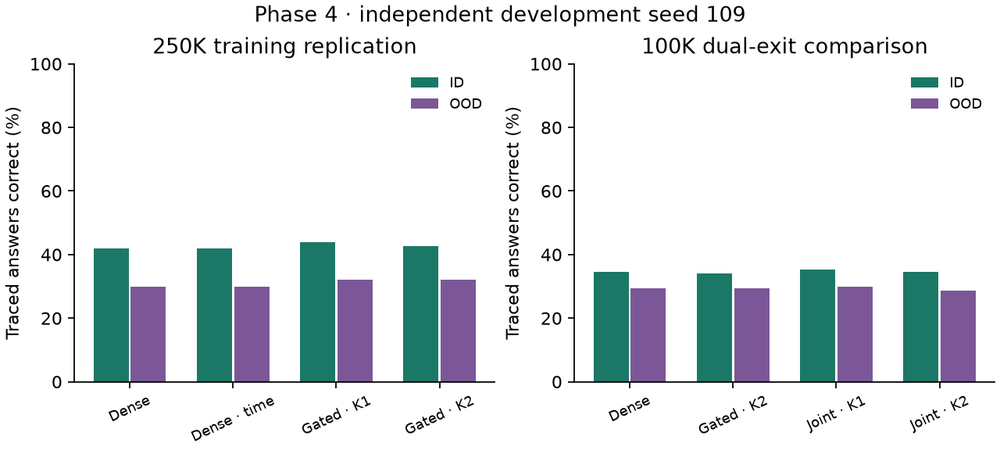
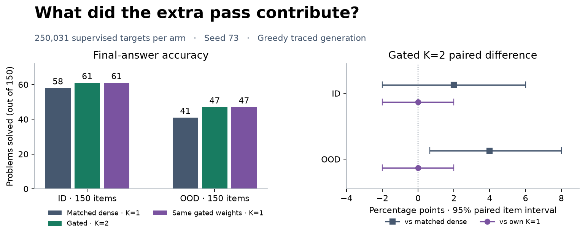
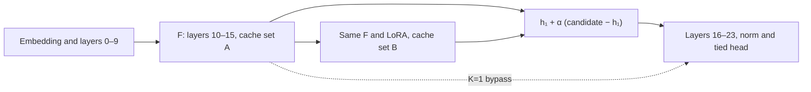

# LoopQwen-MLX

A local MLX research implementation of shared recurrent depth in the official Qwen3.5-0.8B-Base text decoder. The original six-layer architecture runs layers 10–15 twice at K=2. The 30 execution sites reuse 752,393,024 pretrained text parameters. Each recurrent adapter adds 1,336,320 shared LoRA parameters to the six-layer span. Each execution site owns its own attention or Gated DeltaNet state.

On a fresh **131,086-token** register and its key swap, the looped model answered **2/2 versus 0/2** for untouched Base. Eight-bit feed-forward and output weights raised its post-first generation rate to **29.27 versus 27.42 tokens/s**. Including both weight conversions, the two requests finished in **167.39 versus 390.86 s** at **3.32 versus 3.78 GiB** peak MLX allocation. Both individual inputs favored the recurrent system on prompt and output rate. The comparison covers one document with two placements of the same queried name. [Sealed predictions and timings](research/results/register-mixed-weight-full-01) · [Per-request conversion and physical history](paper/mixed-weight-requests.csv)

In two complete project listings of **169,890 and 173,151 input tokens**, both models missed the requested byte count. The loop selected the opening of each listing, over 66,000 tokens from the evidence. It used 2.71 versus 4.51 GiB and finished in 233.62 versus 644.01 seconds across the pair. [Actual Git objects, outputs and cache histories](research/results/repository-tree-field-01)

The full-book test covered 162,714 tokens of Frank Norris’s *McTeague*. The released router chose ordinary depth and matched Base token for token. Both missed the human-written question on the original book and after the character was renamed. [Whole-book comparison](research/results/narrative-full-book-01)

On a separate cold-start stream of 50 field requests, one qualified installation completed **21/50 correctly versus 12/50 for Base** in **83.97 versus 234.20 seconds**. It gained seven net file answers and three SQLite answers, tied on reading and lost one arithmetic answer. Aggregate first-token time more than doubled and peak allocation increased by 5.4 MB. [Five-family comparison with full transcripts](research/results/release-mixed-field-01) · [Per-family scores and timing](paper/mixed-deployment.csv)

A separately trained assistant sharing one instruction backbone across reasoning and tools scored **67/120 versus 50/120** for untouched Base, in **90.44 versus 472.52 s**. On 48 fresh human questions it scored **29 versus 38**. It lost eight previously successful requests and had longer total time to first token. Release 05 is the qualified offline bundle. [Full mixed result](research/results/shared-session-01) · [Family breakdown](paper/shared-session.svg)

The single-adapter experiment preserved all 17 previously grounded public numerical calls and added two. Across 144 mixed requests it scored **74 versus 62** for Base (paired $p=0.148$), and **45 versus 50** on the 72 new human requests. It took 107.60 versus 525.22 seconds and lost twelve earlier field successes. The original comparison uncovered a real tokenizer error on a mixed-script passage. The corrected installed loader reproduced all 144 prescribed opening token streams and all 120 previously valid recurrent trajectories. [Full corrective replay](research/results/shared-session-tokenizer-replay-01) · [Original token mismatch](research/results/shared-session-unified-01/tokenizer-parity.json)

On the 144-request comparison, the loop solved **35 questions that Base missed**. All 35 took less total time and peak memory. On seven, the first token also arrived sooner. In the opposite direction, Base solved 23 questions that the loop missed. [All four metrics per request](paper/paired-request-tradeoffs.csv) · [Breakdown by family](paper/paired-request-tradeoffs.svg)

## Research report and executable tools

The [technical paper](paper/loopqwen.pdf) covers matched depth controls, ordinary reasoning, correct tool execution, time, memory and full-history inference on the same 18 GiB M3 Pro. The [evidence index](paper/study-index.csv) links each claim to its preregistration and native output archive. [Figure sources and reproduction](paper/README.md)

The latest joint two-pass tool checkpoint completed **112/132** tasks versus **15/132** for untouched Base in **69.55 versus 323.35 seconds**. It scored 26/30 and 42/50 on the two catalog panels, 18/22 on human-authored executable questions and 26/30 across four new catalog domains. On 102 requests shared with the earlier typed checkpoint it gained 21 correct tasks and lost five. All five losses involved comparisons. It subsequently lost four of 72 structural calls against the previous tool checkpoint, closing its release replacement gate. [New checkpoint and exact measurements](research/results/tool-dialogue-counterfactual-01) · [Paired gains and losses](paper/joint-tools.csv)

The installed CLI can run that checkpoint using its 3.06 MiB adapter and the already packaged frozen weights. The following command reads the local Python environment.

```sh
.venv/bin/python -m loopqwen tools --checkpoint exports/tool-language-01 \
  --tool-adapter research/results/tool-dialogue-counterfactual-01 --packages \
  --prompt "What version of the Python distribution mlx is installed? Use the tool." --trace
```

A separate trained two-pass tool adapter completed **45/78 grounded requests versus 0/78** for ordinary Base in **54.56 versus 333.15 s**. It answered both properties of six of 16 actual resources, including five with opaque function names, and kept all 17 previous public executions while adding two. When credited for final numbers regardless of tool use, Base solved 14/24 word problems versus 6/24. The adapter remains opt-in. The installed CLI exposes actual calendar, time-zone, Unicode and distribution data through `--resource`. [Archive and weights](research/results/tool-dialogue-intent-pairs-01) · [Live CLI calls and observations](docs/measurements/paired-intent-installed-cli.json)

```sh
.venv/bin/python -m loopqwen tools --checkpoint exports/tool-language-packed-03 \
  --tool-adapter research/results/tool-dialogue-intent-pairs-01 --resource calendar \
  --prompt "What was the ordinal day within the year for 2026-11-26?" \
  --max-tokens 384 --max-turns 3 --no-reuse-prefix --trace
```

On 22 publisher-authored numerical requests the trained two-pass tool model executed the right function with correct arguments and returned the computed answer on **17/22**. Untouched Qwen Base achieved **0/22** complete executions and gave eight correct numbers without calling the function. The recurrent model took **15.15 s** and peaked at **1.08 GiB** versus **82.82 s** and **1.66 GiB** for Base. The tool model shares the final Qwen layer across two applications. Its 8-bit prefix comes from the official instruction-tuned sibling. Training, initialization and precision all contribute to this system comparison. [Predictions, actual callback results and decision](research/results/tool-dialogue-typed-01)

The same weights chose correct names and arguments on **18/24 versus 8/24** multiple-function requests and **16/24 versus 8/24** single-function requests. On the original 22 executions an equally trained one-pass model scored **18/22** against **17/22** for the recurrent model. Shared depth has a demonstrated causal advantage on the induction task; the tool results establish a trained-system advantage over Base. [Independent multi-schema comparison](research/results/tool-bfcl-multiple-01) · [Matched one-pass tool comparison](research/results/tool-dialogue-typed-depth-01)

On original and human-edited BoolQ questions, the first Base-initialized reading adapter finished much sooner and answered both versions correctly on **10/32 passages versus 12/32 for Base**. This candidate missed its accuracy gate. [Reading benchmark and exact paired result](research/results/contrast-boolq-recurrent-01)

An equally trained one-pass tool model solved 108/132 against 112/132 for two passes. The four-task difference had eight paired gains and four losses ($p=0.388$), and two passes used 15.14% more time. The [matched-depth figure](paper/matched-tool-effects.svg) shows how the result changes with the choice of control.

A two-pass semantic alignment model answered 44/48 Wikipedia paraphrase comparisons versus 5/48 for Base. With a fixed answer prefix it scored 44 versus 36, completing both judgments for 20 versus 13 anchors. On 32 real AskUbuntu comparisons it answered “no” every time. Neither model distinguished both alternatives for any support question, and the prespecified transfer requirement closed promotion. [Decisions, weights and generated answers](research/results/meaning-alignment-01) · [Paired endpoints](paper/meaning-pairs.svg)

## Run the offline assistant

The latest qualified offline assistant is **`exports/tool-language-packed-05`**. It matched the pinned Base tokenizer on **5,587/5,587** localized names across 19 languages, up from 3,437, while preserving both 131K answers and all 512 measured book predictions and losses. In a live Hindi exchange it correctly reported NumPy 2.5.5, then repeated it after the tool returned MLX 0.32.4. [Qualification](research/results/packed-release-retention-04) · [Per-language figure](paper/localized-inputs.svg) · [Installed and isolated CLI](docs/measurements/unicode-package-installed-cli.json)

In the preceding release 04 comparison on two 131,084-token requests it returned the correct changed values, 307958 and 481506. Release 03 returned the same incorrect value twice. The repaired bundle applies the learned evidence mask to packed attention and uses compact weights for long register requests. Post-first decoding reached 29.34 and 28.37 versus 17.24 and 17.23 tokens/s with peak MLX allocation of 2.35 versus 2.80 GiB. Both 24K outputs, all 512 book next-token decisions and losses, 12 short generations and two live package replies matched their qualified references. [Complete isolated crossover](research/results/packed-release-retention-03) · [Answers, speed and memory per request](paper/repaired-register-streams.csv)

The earlier release `exports/tool-language-packed-03` enables packed prefill on register requests of at least 16,384 tokens. In an isolated comparison against its parent it answered both 24,593-token swaps identically in 32.44 versus 37.52 s, with peak allocation of 1.94 versus 2.25 GiB. It also reproduced all 512 per-token losses and predictions after reading two whole books, 12 short generations and two actual package calls. [Deployment qualification](research/results/packed-release-retention-01)

On a separate 131,084-token replay, the isolated packed-03 bundle located the correct passages but produced the wrong code on both requests. Its bundled evidence-mask code skipped packed caches. The direct 131K research result uses a runtime that applies the mask. [Isolated outputs](research/results/packed-release-retention-02)

The parent release `exports/tool-language-field-02` established the field CLI and exact language replay. Its self-contained CLI supports Python packages, JSON catalogs, a calculator and SQLite databases. It reproduced all 22 public tool sessions and all 200 shorter language generations. It answered four of five live package queries and both physical 131,083-token register lookups. The lookups took 526.79 seconds combined. Raw-text loss matched the prior release in all five domains, with pooled NLL 2.982658 on 9,328 targets. On four additional CLI requests the installed and isolated runtimes agreed on every token, call and observation. Two satisfied the strict one-call criterion. [Qualification, per-file hashes and exact output streams](research/results/tool-language-release-02) · [Rebuild the export](docs/TRAINING.md#reproducing-executable-tool-training-and-evaluation)

```sh
.venv/bin/python examples/local_packages.py exports/tool-language-packed-03 "What version of the Python distribution mlx is installed in this environment? Use the available tool."
.venv/bin/python -m loopqwen tools --checkpoint exports/tool-language-packed-03 --packages --prompt "What version of numpy is installed?" --max-tokens 256
```

For text inference, `generate --checkpoint exports/tool-language-packed-05 --prompt-file document-and-question.txt --thinking --max-tokens 96` reads the entire UTF-8 input through the same installed `python -m loopqwen` entry point. The returned `context_route` identifies the selected decoder. Add `--compare-base` to run the entire input through both the checkpoint and untouched Base. The JSON includes both completions, a verified prompt-token hash, cold first-token and total seconds, output rates and peak MLX bytes. Omit `--thinking` for raw text continuations.

Use `ask --compare-base` to try your own questions on the installed assistant and untouched ordinary Base. It runs them sequentially with the same opening prompt IDs and thinking budget. You get both replies, executed calls and observations, output counts, measured first-token and full-request time, and peak MLX bytes. The first request includes model loading. Follow-ups preserve each model’s own conversation and report whether the resulting prompt IDs still match. A single run uses recurrent-first order and the OS file cache can persist.

```sh
.venv/bin/python -m loopqwen ask --checkpoint exports/tool-language-packed-03 \
  --prompt-file document-and-question.txt --compare-base --max-tokens 384
.venv/bin/python -m loopqwen ask --checkpoint exports/tool-language-packed-03 \
  --tool-adapter research/results/tool-dialogue-intent-pairs-01 --resource calendar \
  --prompt "Which ISO weekday number corresponds to the leap day 2032-02-29?" \
  --follow-up "For 2032-02-29, what was the ordinal day within that year?" \
  --max-tokens 384 --max-turns 3 --no-reuse-prefix --compare-base --trace
```

In a two-turn leap-day example, the opt-in intent adapter used `weekday_number` and `day_of_year` to answer **7** and **60** for February 29, 2032. Base reached 384 tokens on both turns. The opening prompt was identical and the follow-up inherited each model’s prior exchange. Recurrent request times, including the first cold load, were 1.29 and 0.54 s, against 6.35 and 5.51 s. Both recurrent first tokens took slightly longer. [Actual command, full generated IDs and callback receipts](docs/measurements/user-calendar-comparison.json)

Add one or more `--follow-up "…"` arguments to keep a conversation open across successive requests. The command reports each reply and the live callbacks it used. Python callers can hold `chat = assistant.conversation(tools)` and call `chat.respond(text)` when the next user message arrives.

The CLI also accepts `--catalog definitions.json` for keyed lookups, `--database data.sqlite --table records` for a read-only table, and `--calculator` for exact arithmetic. With `--trace` the response includes every token, submitted argument, callback result and turn time. For custom tools, create a `Tool(name, description, parameters, callback)` and pass it to `Assistant(directory).respond(question, tools)`. The [package example](examples/local_packages.py) uses the Python environment of the running process.

With `--trace`, resident attention runs report each native layer, pass number, consumed offset and retained history. The tool model exposes separate entries for the two applications of layer 23, so a caller can inspect the actual states behind a generated answer.

The installed assistant can inspect the CSV files you supply. It reads quoted UTF-8 records, counts data rows and looks up a named column at a one-based data row. Multiple files can be exposed in one conversation. To compare both models on a project measurement, run:

```sh
.venv/bin/python -m loopqwen ask --checkpoint exports/tool-language-packed-03 \
  --csv paper/mixed-deployment.csv --csv paper/matched-tool-effects.csv \
  --prompt "What is the value in column correct at data row 2 in mixed-deployment.csv?" \
  --compare-base --max-tokens 384 --trace
```

In a separate live exchange, the qualified model read a newly created comparison CSV, counted its four records, and returned the correct field value of 96 on a follow-up. Base printed a proposed call as prose on the first request and reached the second output cap. The trace records each actual tool observation and both layer-23 cache states. [Both conversations](docs/measurements/local-csv-comparison.json)

The installed `ask` command can inspect the byte size or line count of files you select with `--file`. Each supplied path appears in the tool declaration. Byte-size queries read the file metadata, so asking about a model archive does not load its weights. The following runs the released loop and Base on the same request.

```sh
.venv/bin/python -m loopqwen ask --checkpoint exports/tool-language-packed-04 \
  --file exports/tool-language-packed-04.lqzip --file research/experiments/callback-recovery-01.json \
  --prompt "How many bytes are in exports/tool-language-packed-04.lqzip? Check the actual file and give me its size." \
  --follow-up "How many lines are in research/experiments/callback-recovery-01.json? Use the file tool." \
  --compare-base --trace --max-tokens 384 --max-turns 3
```

Both arms executed the correct calls on the example above and returned **1,544,038,893 bytes** and **46 lines**. The two recurrent requests took 1.38 and 0.45 s, compared with 2.93 and 1.78 s for Base. A new standalone export also read the actual 4,006-byte registration outside the checkout. [Installed two-turn comparison](docs/measurements/file-metadata-installed-cli.json) · [Isolated runtime call](docs/measurements/rebuilt-file-runtime.json)

For read-only search over your own text or Markdown files, supply each file using `--document`. The tool returns the original passage, filename and character offsets. For example:

```sh
.venv/bin/python -m loopqwen ask --checkpoint exports/tool-language-packed-03 \
  --document docs/TRAINING.md --document docs/CAPABILITY_SCOREBOARD.md \
  --prompt "In TRAINING.md, what output does the --until option control?" \
  --max-tokens 384 --trace
```


On the repository’s own training guide, the recurrent assistant retrieved the exact Phase 6 shell command and repeated the search twice before reaching the turn limit. Base reached the token limit without a call. On 32 independent article and paper questions the release returned one grounded exact answer versus zero. [Installed document comparison](docs/measurements/local-document-comparison.json) · [All document outcomes](research/results/document-search-field-01)

The installed runtime caches the tokenizer for the qualified packed-03 export. Across four fresh 50-request streams with 200 identical outputs, callbacks and outcomes, the change reduced combined wait on 30 tool/language switches from 29.43 to 16.39 s. Peak native allocation stayed at 1,810,571,734 bytes. Maximum process RSS fell from 2.70 to 1.92 GB. Both policies keep one active backbone. Python callers can reproduce the original behavior with `Assistant(directory, reuse_tokenizer=False)`. The self-contained archive retains the runtime identified by its file hashes. [Verified four-stream crossover](research/results/session-tokenizer-01)

### Restore the offline assistant

The qualified release 05 archive is `exports/tool-language-packed-05.lqzip`, **1,544,038,920 bytes**. It restores all 66 files of the 2,370,317,770-byte assistant. The same files occupied 1,996,857,675 bytes in ordinary ZIP. Restoration and verification took 7.51 s, and the restored assistant reproduced its live package callback and generated tokens outside the checkout. Its SHA-256 is `8c1fbb6850ca72b38e8fa90ebc7c15803f005880a1e43687e224d8016a99a2b3`. From the repository root, restore into an unused directory. [Release 05 verification](research/results/transport-lossless-04) · [Earlier release 04](research/results/transport-lossless-03)

```sh
.venv/bin/python -m loopqwen.weight_transport unpack exports/tool-language-packed-05.lqzip exports/restored-tool-language-packed-05
.venv/bin/python -m loopqwen tools --checkpoint exports/restored-tool-language-packed-05 --packages --prompt "What version of mlx is installed? Use the tool."
```

### Experimental raw-language checkpoint

A Base-initialized two-pass model improved loss, top-one accuracy, elapsed time and peak MLX allocation on each of three raw-text suites. Across 300 passages and 36,126 targets it made **15,076 versus 15,006** correct predictions for Base, reached NLL **3.06194 versus 3.08052**, and took **20.81 versus 24.21 seconds**. Natural history lost four predictions and the fresh loss gain fell below its registered margin. The qualified assistant keeps its prior ordinary-language behavior. To generate a raw continuation with these separate experimental weights, run the following on Apple Silicon. [Weights and verification](research/results/selective-raw-01) · [Scores by domain](paper/selective-domains.csv)

```sh
.venv/bin/python -m loopqwen generate --checkpoint research/results/selective-raw-01 --prompt "The telescope recorded a faint" --max-tokens 32
```

The public generator reproduced the sealed first prediction on a 32-token novel prefix and generated eight tokens through the same cache. [Actual prompt, output IDs and timing](docs/measurements/selective-raw-public-cli.json)

## Current combined checkpoint

Use [the native recurrent checkpoint](research/results/native-language-release-02/model) on Apple Silicon. On two disjoint three-fact induction panels it answered **124/128** correctly. A one-pass model with the same 552,810 trainable parameters, training stories and update count answered **58/128**. Both produced 13 tokens per answer and took about 32 seconds for all 128 questions. With the three-pass weights held fixed, disabling two applications of Qwen layer 15 dropped confirmation accuracy from **62/64 to 19/64**. Untouched Qwen Base answered **2/64 in 654.19 s** at the same 768-token allowance as the loop, which answered **62/64 in 16.02 s**. A second training seed scored 53/64 versus 25/64. [Matched results and limits](docs/CAPABILITY_SCOREBOARD.md#three-fact-induction-with-a-repeated-native-qwen-layer) · [Same-weights ablation](research/results/native-induction-anchored-bypass-01) · [Full-budget Base comparison](research/results/native-induction-anchored-longbase-01)

The induction reader compresses each short premise and the question into Qwen sentence states. The same trained native decoder layer refines the question state three times against the premises. Its final state adjusts next-token logits of the ordinary full-prompt decoder. The benchmark uses generated English stories and a fixed induction convention. In a separate human-paraphrased kinship study, three passes scored 34/64, the matched one-pass model scored 44/64, and untouched Base scored 1/64. The combined model selects this reader from the submitted story and question and retains its earlier text and long-context routes.

The standalone export reproduced the exact token streams on **64 induction, 56 deduction and 80 mixed requests**. All 192 same-story questions about other attributes kept the previous route, and nine paired public generations reproduced every token. Raw language NLL matched Base at **2.982658 over 9,328 targets**. The model read **131,083 input tokens**, generated 30 tokens and retrieved the correct key on both sides of a fixed-position register swap. The two requests took **525.84 s** together at a run peak of **4.33 GiB** in MLX. Base scored 0/2 in 393.20 s on those same long prompts. The register reader handles this measured long-context workload. [Release qualification and standalone inventory](research/results/native-language-release-02) · [Frozen Base long-context comparison](research/results/conditional-language-128k)

Run the first held-out confirmation question through the normal CLI. It asks for Brian's color and the visible answer is `yellow`.

```sh
.venv/bin/python scripts/reader_prompt.py --study native-induction-anchored-01 --index 0 > /tmp/loopqwen-induction.txt
.venv/bin/python -m loopqwen generate --checkpoint research/results/native-language-release-02/model --thinking --prompt-file /tmp/loopqwen-induction.txt --max-tokens 768
```

The locally built standalone directory is `exports/native-language-release-02`. To recreate it in a new directory from the pinned Base snapshot, run `.venv/bin/python -m loopqwen export --checkpoint research/results/native-language-release-02/model --output exports/my-native-loop`. Its isolated-process check covers both reasoning readers and all decoder banks. [Training and reproduction](docs/TRAINING.md#reproducing-the-three-pass-native-layer-comparison) · [Complete export file hashes](research/results/native-language-release-02/export-files.json) · [Verified public CLI requests](docs/measurements/native-language-release-cli.json)

## Previous two-fact checkpoint

The preceding deployment is `research/results/evidence-language-release-01/model`. On two disjoint bAbI deduction panels, the learned two-read model answered **112/112** questions. Its equally trained one-read control answered **68/112**. Both generated the same number of tokens. On the 56-question confirmation panel with 768 tokens available, untouched Qwen Base answered **32/56 in 471.48 seconds** and the reader answered **56/56 in 15.31 seconds**. Running both evidence reads on single-pass Qwen sentence features also scored 56/56. These measurements attribute the gain to following a second piece of evidence. [Matched primary](research/results/deduction-matched-01) · [Disjoint confirmation](research/results/deduction-replication-01) · [Native span ablation](research/results/deduction-span-bypass-01)

The shipping model reproduced every output token on the earlier 80-request mixed benchmark and on the 56 deduction confirmation requests. The 120-passage raw language NLL remained **2.982658**. It answered both counterfactual register lookups correctly after **131,083 input tokens** and generated 30 tokens in each case, using 4.33 GiB peak MLX memory. The two long requests took 526.06 seconds combined. The added deduction reader handles short newline-separated statements followed by a question. The established register reader handles the long key swaps. [Checkpoint and complete deployment replay](research/results/evidence-language-release-01)

## Earlier combined checkpoint

The original combined checkpoint is `research/results/conditional-language-02/model`. On 80 fresh requests it answered **55/80 versus 41/80** for untouched Qwen Base after blind answer review, with 14 gains and zero lost correct answers. Generation took **419.12 versus 536.26 seconds** on an 18 GiB M3 Pro. The strict scorer gave 49/80 versus 33/80. All 34 requests handled at ordinary depth reproduced the Base output tokens, and all 120 raw language passages reproduced its NLL exactly. Reading tied at 2/8. The selector used the inference specialist on 10/36 inference questions, with the other 26 handled at ordinary depth. [Deployable checkpoint and paired outputs](research/results/conditional-language-02) · [Workload breakdown and matched dense controls](docs/CAPABILITY_SCOREBOARD.md#combined-arithmetic-inference-and-register-model) · [Blind review](docs/measurements/answer-audits/conditional-language-02.json)

The **same checkpoint** consumed **131,083 input tokens** and decoded 30 tokens on each side of a verified synthetic register key swap. It retrieved **281711** near token 13,098 and **386927** near token 98,294, scoring **2/2 versus 0/2** for Base. Total generation took **524.50 versus 393.20 seconds**, with a measured run peak of **4.32 GiB** in MLX. The two three-token keys exchanged positions. Every other input token stayed fixed. [Frozen prompts and native 128K results](research/results/conditional-language-128k)

Run a measured inference example through the public CLI. Its visible answer is `Yes.`

```sh
.venv/bin/python -m loopqwen generate \
  --checkpoint research/results/conditional-language-02/model \
  --thinking --max-tokens 1024 \
  --prompt 'Take this information as given: People working together to plant flowers.
Consider this statement: People are planting flowers.
Is the statement supported, contradicted, or left undecided by the information? Answer yes, no, or maybe in that order of meanings.'
```

The self-contained native bundle shares the Base weights among three unmerged adapter banks and contains 756,444,138 unique parameters. A fresh process reproduced each bank’s vocabulary logits, six archived generation paths reproduced their tokens, and the public CLI reproduced the example above. [Standalone replay evidence](docs/measurements/conditional-language-export.json) · [Public CLI output](docs/measurements/conditional-language-cli.json) To rebuild it from the checkpoint, run `.venv/bin/python -m loopqwen export --checkpoint research/results/conditional-language-02/model --output exports/conditional-language-02` in a checkout with the pinned Base weights. [Training and deployment](docs/TRAINING.md#learned-exit-and-natural-inference)

## Learned full-history retrieval

The released passage reader answered **8/8** held-out lookup questions across 2K and 16K contexts. Untouched Base answered **0/8** on the same thinking prompts with the same 96-token output allowance. Total generation time was **52.2 s versus 45.1 s**. The reader adds 32,929 learned parameters to the frozen arithmetic checkpoint. All 32 archived short math answers reproduced token for token. [Reader checkpoint, prompts and outputs](research/results/attention-memory-01) · [Measured accuracy and cost](docs/CAPABILITY_SCOREBOARD.md#frozen-arithmetic-decoder-with-a-learned-passage-reader)

At **131,078 input tokens**, the same reader answered **2/2** full-history requests in **643.7 s** on an 18 GiB M3 Pro. Base answered **0/2 in 499.7 s**. The two documents contain the same question and every number in the same position. Swapping two record names moved the right answer from token 13,124 to token 98,297. The reader produced both different values. These are two versions of one synthetic document. [Full-context outputs and timing](research/results/attention-memory-128k)

On **12 natural Wikipedia reading questions** with roughly 2K tokens of same-topic paragraphs, the reader scored **2/12 exact** in 27.5 s and Base scored **4/12** in 32.6 s. The learned span overlapped the annotated source paragraph on only three requests. The released reader is a register-lookup specialist. Base remains the general reading reference. [Natural prose transfer results](research/results/prose-reading-01)



Reproduce the first 2K request on Apple Silicon. The expected visible answer is `191242`.

```sh
.venv/bin/python scripts/reader_prompt.py > /tmp/loopqwen-register.txt
.venv/bin/python -m loopqwen generate --checkpoint research/results/attention-memory-01/model --thinking --prompt-file /tmp/loopqwen-register.txt --max-tokens 96
```

## Replicated natural-language inference improvement

On 120 human-written e-SNLI and MultiNLI judgments, the trained recurrent model answered **85/120** correctly against **66/120** for untouched Base after blind review of noncanonical answers. It improved on both sources in each independent panel. A separate vocabulary-probability test scored **88/120 versus 54/120**. Across 40 premises with one entailed, one contradicted and one undecided claim each, it solved **15 complete triplets versus 3**. Unrestricted generation took **39.08 versus 966.67 seconds** at the same 1,024-token allowance. The pooled two-sided permutation test preserving entire premises gave **p = 0.0070** on the reviewed judgments. [Native checkpoint and first pair](research/results/entailment-triplets-01) · [Independent pair with new wording](research/results/entailment-triplets-confirm-01) · [Blind results by corpus](docs/measurements/answer-audits/entailment-triplets-pooled.json)

An equally trained ordinary-depth inference model also scored 85/120 and solved 15/40 complete triplets. It selected 91/120 correct probability probes versus 88/120 for the recurrent model, and used 31.92 versus 39.13 seconds in the attribution run. [Matched natural inference control](research/results/entailment-dense-01)

## Replicated full-budget arithmetic improvement

The same learned-exit checkpoint answered **52/80** word problems correctly against **46/80** for untouched Qwen Base at a common **1,024 generated tokens**. With blind credit for completed answers in prose, the totals were **58/80 versus 52/80**. It gained answers on both reserved GSM8K and SVAMP in each panel. The six wins rescued unfinished Base turns, with zero paired losses. All six shared prefixes had already calculated the correct number before the depth switch. Elapsed generation time, including recurrent replay, was **542.44 versus 592.24 seconds** on the M3 Pro. The nominal two-sided paired test on these two panels gives **p = 0.03125**. The project explored multiple earlier designs. Raw language NLL was 2.99538 versus 2.98266. [Primary pair and checkpoint](research/results/learned-exit-01) · [Independent replication](research/results/learned-exit-confirm-01) · [Blinded pooled scores](docs/measurements/answer-audits/learned-exit-pooled.json)

An ordinary-depth finisher trained on the same 128 documents also scored 52/80, agreeing with K2 on correctness for every item. Its replay took 524.69 seconds versus 528.14 seconds at K2. The gain against untouched Base does not isolate an arithmetic benefit from the extra pass. [Matched finisher comparison](research/results/learned-exit-dense-01)

The model uses ordinary depth for the first 704 generated tokens. If the thought remains open, it reprocesses the entire sequence at recurrent depth and chooses subsequent tokens from the full vocabulary. To run this checkpoint, pass `--checkpoint research/results/learned-exit-01/model --thinking --max-tokens 1024` to the native `generate` command. The self-contained native export reproduces the measured token stream through a real depth switch.



## Thinking-enabled word problems

The stabilized K=2 checkpoint trained on 128 publisher-written GSM8K explanations answered **13/32** development questions correctly in **64.6 seconds**. Untouched Qwen Base K=1 answered **1/32** in **118.1 seconds** on identical prompts with a 256-token limit. The candidate produced 32 scorable answers and Base produced one. The candidate fixed 13 Base errors and lost one correct answer. Its prose-retention NLL was 2.9873 against Base at 2.9827. These 32 questions had been used in earlier development studies. [Checkpoint and per-question outputs](research/sessions/2026-11-25/gsm-rationale-01) · [End-to-end review](docs/PROJECT_REVIEW.md)

On **48 fresh public word problems**, the same adapter answered **23/48** correctly within 256 tokens in **82.6 s**, compared with **9/48 in 172.9 s** for untouched Base. With 1,024 tokens, Base reached **31/48 in 383.1 s** and the adapter reached **23/48 in 114.1 s**. All 23 of the adapter’s correct turns finished by token 167. The longer-budget promotion gate failed. [Frozen prompts and paired results](research/results/rationale-transfer-01)

Two follow-up training methods also beat Base at 256 tokens on separate 32-question cohorts. Inverse-checked supervision scored **12 vs 3** and sampled-solution preference training scored **16 vs 2**. Both trailed Base at 1,024 tokens. Giving the original adapter and Base multiple attempts within one shared 1,024-token allowance produced **20/32 vs 25/32** in **283.2 vs 468.6 seconds**. [Follow-up scores and costs](docs/CAPABILITY_SCOREBOARD.md#follow-up-evidence-on-language-retrieval-and-prefill)

A different trained checkpoint preserves the first 512 greedy Base tokens when thinking is enabled. If the thought is still open, it reprocesses the entire prefix at K=2 and finishes within the original allowance. On 48 fresh problems at 1,024 tokens it scored **27/48 vs 25/48** for Base in **353.05 vs 380.68 seconds**, including the second prefill. The gain came from two additional SVAMP answers. GSM8K tied. A blind review that credited correct visible answers written in prose gave **31/48 vs 30/48**. The result fell below the registered promotion margin. The native CLI loads this research checkpoint with `--checkpoint research/results/recurrent-deliberation-01/model --thinking --max-tokens 1024`. [Frozen paired outputs and checkpoint](research/results/recurrent-deliberation-01) · [Answer review](docs/measurements/answer-audits/recurrent-deliberation-01.json)



Run the measured adapter on a native Apple Silicon Mac with the locked environment and pinned Base checkpoint.

```sh
.venv/bin/python -m loopqwen generate --checkpoint research/sessions/2026-11-25/gsm-rationale-01/model --thinking --max-tokens 256 --prompt 'Rocky boxed 190 fights in his career.  50 percent of his fights were knockouts, and 20 percent of the knockouts were in the first round.  How many knockouts did Rocky have in the first round?
Reason briefly, then give a single number on the last line as Final answer: <number>.'
```

On the same development set with identical training exposure, the ordinary-depth adapter answered **10/32 in 53.6 s**. The recurrent adapter gained six answers and lost three against that control. Both used 32 updates and 10,083 supervised response tokens. [Matched dense checkpoint and scores](research/results/rationale-dense-01)

The arithmetic adapter alone processed **131,072 input tokens** and completed its response on the 18 GiB M3 Pro. Time to first token was **261.3 s**. It returned 13494 for an early ledger entry whose value was 965265. This earlier run established full-context capacity and recorded a failed lookup. [128K deployment record](research/results/context-rationale-128k)

For long prompts, `--prompt-file path/to/prompt.txt` reads the entire UTF-8 file. The optional `--offload-dir /path/to/scratch` stores full-precision KV prefixes on disk while keeping every position accessible to attention. [Context protocol and reproduction](docs/PROJECT_REVIEW.md)

## What recurrence contributes

On **128 unseen arbitrary document-link maps**, both models received the same explicit three-hop question and generated only the requested final number. The ordinary-depth model answered **61/128** correctly at **107 ms** median latency. The three-pass model answered **44/128** at **150 ms**. Both completed every request after identical training exposure. A one-link lookup answered 51/128 correctly. [Scoreboard](docs/CAPABILITY_SCOREBOARD.md)

Both arms of the six-hop retention study completed their 16 updates. Mixing two old-task examples per batch preserved 57/96 old-task answers versus 39/96 for the functional-only control. Both reached 21/128 on the new endpoint and zero complete paths on 78 maps with moving final steps. The parent retained 96/96, so the mixed model missed its retention requirement. [Paired comparison](research/results/functional-interleave-01)

## Can it generate a complete verified answer?

Training the shared block on 256 gold room trajectories raised complete three-hop answers from **0/64 to 64/64** on fresh maps. Its categorical third-hop score fell from 95/96 to 81/96. A frozen-block suffix adapter preserved 95/96 and generated one correct path. On public development anchors, the previous verbal transfer checkpoint at K=3 scored **1/32 on GSM8K** and **18/32 on ARC-Easy**, compared with 2/32 and 18/32 for untouched Base. GSM8K measures generated numeric answers. ARC uses normalized choice likelihood. [Capability scoreboard](docs/CAPABILITY_SCOREBOARD.md) · [Experiment ledger](docs/RESEARCH_LOG.md) · [Active research state](research/state.json)

On **96 further unseen maps**, a single-pass model trained on those same examples solved **96/96** complete trajectories (198 ms median). The recurrently trained checkpoint solved **95/96 at K=3** (447 ms) and **32/96 at K=1**. A subsequent joint state-and-response objective restored categorical retention while generating **64/64** verified room traces. On a separate zero-shot structural test, the six-hop symbolic model solved **190/192** complete permutation paths and **6/192** arbitrary successor paths.



## Can the model choose better training examples?

In the new document-reference comparison, the qualified parent produced **47/64** verified paths. Two generations using verified model responses reached **50/64 and 57/64**. Gold supervision reached **61/64 and 60/64** with the same update budgets. All 32 selected model responses exactly matched the gold tokens on their respective maps, and model sampling added 47.7 seconds. [Paired results and costs](docs/CAPABILITY_SCOREBOARD.md#verified-self-training-on-document-references)

On a fresh six-hop pointer cohort, two generations of learner-selected training reached **248/256** correct terminal states versus **236/256** for static selection at equal updates. When static training received the same time allowance, it reached **255/256**. An independent curriculum seed stopped after one matched round under the registered retention rule. A separate self-training trial produced **zero fully verified trajectories in 32 sampled responses**, including 17 correct final numbers. Static training remains the stronger measured six-hop operating point. [Capability scoreboard and compute accounting](docs/RSI_RESULTS.md) · [Frozen study](docs/RSI_PLAN.md)

## What another 1,152 map presentations bought

With its original optimizer restored, the seed-109 recurrent checkpoint improved from **360 to 384 correct canonical third hops out of 384**. Across eight shuffles of those same unseen maps it improved from **93.91% to 99.84%**. The paired map-bootstrap interval for the gain was **+4.10 to +7.94 percentage points**. The architecture, map set and adapter capacity stayed fixed. System memory pressure ended training at update 624 of a planned 960.

A separate 60-update pilot taught the original Qwen vocabulary head to emit the third-hop digit on **187/192** held-out verbal prompts, up from **39/192** before transfer. The categorical mechanism retained 99.35% shuffled third-hop accuracy. Prose NLL was 3.033 at K=1 and 3.488 at K=3, against untouched Base at 2.983. Free-form reasoning remains unresolved. The better of two thinking-enabled Base prompts gave five valid answers out of eight and missed the six-answer gate. [Vocabulary pilot and retention](docs/PHASE7_RESULTS.md#full-vocabulary-transfer)

The improvement carried past the trained depth. On the fixed random presentation, sixth-hop accuracy rose from **106/384 to 284/384**. Across four display-order conditions, transplanting a carried hidden vector caused the recipient to advance from the donor state on **61–62/64** cases per condition. The unmodified and matched-noise controls scored **0/64** each. This evidence applies to an eight-state categorical task on one development seed. [Phase 7 findings and gate decisions](docs/PHASE7_RESULTS.md) · [Training and reproduction](docs/TRAINING.md#phase-7-exact-exposure-continuation)



```sh
.venv/bin/python scripts/phase7_predict.py --map 5 4 7 6 0 2 1 3 --start 0 --depth 3
python3 scripts/verify_phase7_archive.py
```

## Generalization to shuffled pointer maps

Changing only the training display order raised third-hop accuracy from **46.9% to 93.9%** and complete three-hop paths from **43.7% to 93.5%** across eight presentations of each of 384 unseen development maps. The same recurrent checkpoint achieved **360/384 (93.75%)** on canonical third hops, five maps short of the registered 95% floor for promotion. This is a categorical prediction from Qwen's shared middle layers. The Phase 6 language-transfer and confirmation stages remain gated. [Phase 6 results](docs/PHASE6_RESULTS.md) · [Registered study](docs/PHASE6_PLAN.md) · [Reproduction](docs/TRAINING.md#phase-6-matched-installation)

The strongest dense control achieved **19.1%** on shuffled third hops. The separately scored thinking-enabled deployment pair hit its prespecified floor. On six identical questions, both the base and trained loop used all 384 tokens before emitting a final answer. Base took 34.6 seconds and the loop took 56.8 seconds. Ordinary answer quality remains unresolved. [Two-model scores](docs/measurements/phase6/reasoning-pair/scores.json) · [Independent review handoff](docs/PHASE6_REVIEW.md)



```sh
.venv/bin/python scripts/phase6_predict.py --arm randomized --map 5 4 7 6 0 2 1 3 --start 0 --depth 3
python3 scripts/verify_phase6_archive.py
```

[Released adapter and readout](docs/measurements/phase6/randomized) · [Full measurement archive](docs/measurements/phase6)

## Learning an internal pointer transition

With an explicit state target after each application, the same six Qwen layers learned to follow an eight-node permutation. At seed 109 the shared recurrent model predicted all three successive states on **384/384 unseen development maps**. At the same map exposure the dense middle, dense full and frozen controls completed **1, 10 and 0** paths. A shared eight-way head reads the state. This experiment used no generated tokens between passes.

Changing the order of the displayed edges reduced third-hop accuracy to **36/64**. Transplanting a hidden vector from a different map made the next prediction follow the recipient map from the donor state in **64/64** registered cases, compared with **0/64** without the transplant. A second transplant check with 64 distinct donor maps also scored 64/64. The categorical model reached 384/384 at the untrained fourth hop. In a verbal rendering, ordinary greedy three-hop digit generation scored 42/96 at K=3, 1/96 with the same weights at K=1 and 15/96 for the untouched base. Prose retention worsened at K=3. These are exploratory results on one task and one training seed. [Phase 5 results](docs/PHASE5_RESULTS.md) · [Architecture](docs/PHASE5_ARCHITECTURE.md) · [Registration](docs/PHASE5_PLAN.md)



Run the compact categorical checkpoint from the repository root with the locked native environment and pinned base model.

```sh
.venv/bin/python scripts/phase5_predict.py --arm recurrent --map 5 4 7 6 0 2 1 3 --start 0 --depth 3
python3 scripts/verify_phase5_archive.py
```

[Installed adapter and state head](docs/measurements/phase5/models/recurrent) · [Terminal-only continuation](docs/measurements/phase5/models/outcome) · [Study commands](docs/EXPERIMENT_REGISTRY.md#phase-5-pointer-installation)

## Learning useful recurrent computation

Phase 4 tests two deployment questions. Can training with an extra block pass improve a checkpoint that runs at ordinary K=1 inference cost? Can explicitly supervising both exits make the second pass solve problems that its own first pass misses? The language experiments use real Qwen weights, both matched-data and matched-training-time dense controls, and the same greedy development prompts. Phase 5 now trains the shared block to predict successive states on an eight-node pointer task. Its primary comparison and registered persistence checks are complete. [Phase 5 registration](docs/PHASE5_PLAN.md) · [Categorical architecture](docs/PHASE5_ARCHITECTURE.md). [Study registration](docs/PHASE4_PLAN.md) · [Architecture and objectives](docs/PHASE4_ARCHITECTURE.md) · [Reproduction](docs/EXPERIMENT_REGISTRY.md#phase-4-experiments)

On the 18 GiB M3 Pro, the integrated 360-position physical microbatch cap reduced peak MLX allocation from 6.85 to 4.63 GiB on the matched profile. Both arms kept four examples per optimizer update. At seed 109, dense and gated training consumed the same 250,211 supervised targets. The dense control reached 334,012 targets when given the gated model’s optimizer time. [Training guide](docs/TRAINING.md)

Seed 109's 250K model solved **114/300 traced development problems at K=1**, versus **108/300** for both dense controls. Its second pass reduced that total to **112/300**. Neither answer fixed by the extra pass had a verified derivation. The two-point single-pass gain fell below the registered promotion threshold. Jointly supervising both exits at 100K also favored running once (98/300 versus 95/300). [Phase 4 results](docs/PHASE4_RESULTS.md)



A reviewer can verify the published files and recount all nine traced comparisons from a fresh clone with `python3 scripts/verify_phase4_archive.py`. This uses the Python standard library and requires no model download. [Per-item records](docs/measurements/phase4/eval/primary) · [Paired results](docs/measurements/phase4/primary-pairs.json)

## Phase 3 development result

The development study compares dense adaptation, direct recurrence and a near-identity refinement at the same 100,068 supervised tokens. A single learned sigmoid controls the extra pass. Every recurrent checkpoint also runs at true K=1 so its adapters can be evaluated without the extra computation. The primary outcome is greedy final-answer accuracy on traced problems. Exact procedural certificates, independent language retention and measured latency provide additional evidence. [Registration and reproduction](docs/EXPERIMENT_REGISTRY.md) · [Architecture](docs/PHASE3_ARCHITECTURE.md)

At 250,031 matched supervised tokens, the learned-gate checkpoint solved **61/150 fresh ID and 47/150 fresh OOD development problems**. Bypassing its second pass produced the same two totals. On each split the extra pass fixed one answer and broke one. The matched dense checkpoint scored 58/150 and 41/150. This seed suggests a possible training-time benefit. It gave us no net final-answer gain from running the extra six layers at inference. The registered promotion rule kept the three-seed confirmatory test sealed. [Dense adapter](adapters/phase3/p3_dense_250k) · [Learned refinement adapter](adapters/phase3/p3_learn1_250k) · [Development results](docs/PHASE3_RESULTS.md)



## Run the seed-109 model

On a native arm64 Mac, install the locked environment and resolve the pinned Base checkpoint. The 250K gated adapter's best observed traced accuracy on this cohort came at K=1.

```sh
./scripts/bootstrap.sh
source .venv/bin/activate
python -m loopqwen download
python -m loopqwen generate --checkpoint adapters/phase4/gated_109_250k --passes 1 --prompt 'Evaluate (((4 - 13) - 14) * 3).
Show your steps. End with Final answer: <number>.
Solution:' --max-tokens 192
```

The K=1 adapter generated the following verified solution for that prompt during the batched development evaluation.

```text
4 - 13 = -9
-9 - 14 = -23
-23 * 3 = -69
Final answer: -69
```

Use `--passes 2` to run the extra pass. The matched dense model is in `adapters/phase4/dense_109_250k`. Earlier published adapters and their measurements remain available in the [experiment registry](docs/EXPERIMENT_REGISTRY.md).

## Reproduce the study

The [experiment registry](docs/EXPERIMENT_REGISTRY.md) lists the ordered commands from data preparation through training, evaluation and archival. The [training guide](docs/TRAINING.md) explains checkpoints and update budgets. The [performance report](docs/PHASE3_OPTIMIZATIONS.md) records historical deployment measurements on the 18 GiB M3 Pro. The [Phase 4 trainer profile](docs/PHASE4_OPTIMIZATIONS.md) reports target throughput, memory and checkpoint cost.

Measured figures include the [development learning curves](docs/measurements/phase3/learning-curves.png) and [memory over 1,605 gated updates](docs/measurements/phase3/training-memory.png).

## Shared block and independent caches



## Historical experiments

The 1,000-update loop answered 59/110 held-out procedural questions correctly. The same checkpoint at K=1 answered 55/110, and the matched dense twin reached 65/110. The experiment compares the untouched base, the untrained loop and two matched trained twins. Its primary outcomes are held-out answer loss and greedy numeric accuracy. Prose retention, variable depth and a longer-output dense control are also measured. [Experimental results](docs/RESULTS.md)

## Try the trained loop

The repository includes small inference adapters for both training pairs. From a clone, run

```sh
./scripts/bootstrap.sh
source .venv/bin/activate
python -m loopqwen download
python -m loopqwen generate --checkpoint adapters/extended_loop --prompt 'Question: 17 × 23
Answer:' --max-tokens 16
```

## Reproduce the pilot

Use a native arm64 macOS Python environment and run these commands from the repository root. Bootstrap uses uv when available and otherwise creates a Python 3.12 venv with constraints from the lockfile. The default dataset builder downloads small pinned public math splits. The model download uses the official Base checkpoint.

```sh
./scripts/bootstrap.sh
source .venv/bin/activate
python -m loopqwen download
python -m loopqwen baseline
python -m loopqwen probe --start-layer 10 --num-layers 6 --passes 2
python -m loopqwen cache-check
python -m loopqwen gradient-check
python -m loopqwen gdn-check
./scripts/run_pilot.sh
python -m loopqwen benchmark --config configs/benchmark.yaml
python -m pytest -q
python -m loopqwen export --checkpoint checkpoints/pilot_loop --output exports/loopqwen-0.8b
python -m loopqwen generate --checkpoint exports/loopqwen-0.8b --prompt 'What is 17 times 23?' --max-tokens 32
```

The pilot script builds data, trains both 12-update smoke runs, trains both 200-update pilots and runs evaluation. A completed run name reuses its latest checkpoint. A clean checkout reproduces training from the official weights. The full integration suite expects the completed pilot and its manifest.

## Individual commands

```sh
python -m loopqwen doctor
python -m loopqwen data --preset pilot
python -m loopqwen train --config configs/smoke.yaml --until 6
python -m loopqwen train --config configs/smoke.yaml
python -m loopqwen train --config configs/pilot_dense.yaml
python -m loopqwen train --config configs/pilot_loop.yaml
python -m loopqwen evaluate --experiment pilot
python -m loopqwen compare --experiment pilot
python -m loopqwen report --experiment pilot
python -m loopqwen generate --checkpoint checkpoints/pilot_loop --prompt 'Question: 17 × 23
Answer:' --max-tokens 16
```

The base model uses raw text. The adaptation examples use a question followed by a newline and `Answer:`. Generation is greedy, capped and EOS-aware. Adapter checkpoints require the pinned base snapshot. The BF16 merged export includes its own tokenizer and recurrent runtime, with a fresh-process check on every logit of the export verification prompt.

## Reproduce the extended comparison

The 1,000-update pair starts from the same pretrained base, using four documents per update and the existing pilot splits. In the activated environment, run the following commands after building the data.

```sh
python -m loopqwen train --config configs/extended_dense.yaml
python -m loopqwen train --config configs/extended_loop.yaml
python -m loopqwen evaluate --experiment extended
python -m loopqwen compare --experiment extended
python -m loopqwen export --checkpoint checkpoints/extended_loop --output exports/loopqwen-extended-0.8b
```

## Project files

| Path | Contents |
|---|---|
| `configs/` | Hardware presets, matched training runs, benchmark and evaluation settings |
| `loopqwen/looped_model.py` | Shared execution schedule, interpolation and tied output head |
| `loopqwen/recurrent_cache.py` | Independent execution-site caches |
| `loopqwen/kernels/gdn_backend.py` | Validated native training path and stock fallback |
| `loopqwen/training/` | Adapter placement, token-weighted loss, optimizer and trainer |
| `loopqwen/checkpoint.py`, `loopqwen/export.py` | Atomic resumable generations and merged export |
| `data/pilot/` | Local tokenized examples, split digests and source manifest |
| `checkpoints/<run>/latest.json` | Pointer to the most recent complete generation |
| `outputs/<experiment>/` | Each generated answer, decoding settings, scores and Markdown comparison |
| `docs/` | Measured results, implementation details and reproduction notes |

The code license is MIT. Official Qwen weights retain their own license, copied into merged exports. GSM8K and MATH source licenses are recorded beside the downloaded data. Full backbone weights, merged exports, local optimizer checkpoints and raw datasets stay outside Git. The four compact adapter bundles are included. [Architecture](docs/ARCHITECTURE.md) · [Training](docs/TRAINING.md) · [Metal benchmarks](docs/METAL_OPTIMIZATIONS.md) · [Troubleshooting](docs/TROUBLESHOOTING.md) The natural reading panel adapts SQuAD v1.1 by Rajpurkar and colleagues and the contributing Wikipedia authors. It reorders complete paragraphs from each named article and distributes those transformed data under CC BY-SA 4.0. [Publisher and source download](https://rajpurkar.github.io/SQuAD-explorer/) · [CC BY-SA 4.0](https://creativecommons.org/licenses/by-sa/4.0/)

## Phase 2 recurrent-depth study

V2 uses 24,000 distinct procedural problems with verified derivations, a separate answer-only prompt, held-out difficulty regimes and independent prose retention data. The historical pilot and extended runs retain their original scoring protocols. The [registered design](docs/PHASE2_PLAN.md), [architecture audit](docs/PHASE2_ARCHITECTURE.md), [Metal investigation](docs/PHASE2_OPTIMIZATIONS.md) and [first V2 development comparison](docs/measurements/phase2/phase2_direct/comparison.md) describe the new study.

From the project root on native Apple Silicon:

```sh
uv sync --locked --group figures
.venv/bin/python -m loopqwen download
.venv/bin/python -m loopqwen data --preset v2
.venv/bin/python -m loopqwen train --config configs/phase2/p2_a_trace_dense.yaml
.venv/bin/python -m loopqwen train --config configs/phase2/p2_a_trace_loop.yaml
.venv/bin/python -m loopqwen compare --experiment phase2_direct
```

`scripts/run_phase2.sh` runs all registered controls, development selection, three confirmatory seeds and diagnostics sequentially. Use a separate checkout for an independent reproduction. In the original workspace, identical configurations resume using their saved optimizer and deterministic cursor. The `figures` dependency group supplies Matplotlib. Group-level evaluation requires every registered checkpoint to be complete. The comparison command can also read the archived table in a fresh clone.

For fast checks independent of model weights or Metal, use `python -m pytest -q tests/test_phase2.py -k 'numeric or gold_and_fingerprints'`. The remaining Phase 2 checks require the locked environment and built V2 corpus. The historical integration suite also requires the original pilot dataset and completed pilot checkpoints. The expensive three-seed experiment runs through the study script separately from pytest.

`python -m loopqwen resources` lists project processes, their parent PIDs, the current exclusive GPU lease, OS memory pressure and swap occupancy. A standalone model worker acquires the lease before loading weights. The study launcher runs one coordinator per checkout and forwards cancellation to its process group, allowing an active trainer to save at an update boundary. A lock file may remain on disk after exit. The resources command checks the kernel lock to determine whether a worker owns it.

The [completed three-seed Phase 2 report](docs/PHASE2_RESULTS.md) includes ID and OOD accuracy, uncertainty, measured compute controls, prose retention, export parity and memory measurements. The [seed-43 recurrent adapter](adapters/p2_confirm_43_loop) and its [matched dense twin](adapters/p2_confirm_43_dense) load directly with the generation CLI. Subsequent study reproductions write an independent archive under `outputs/phase2/reproduction/` once the original results have a checksum index.
