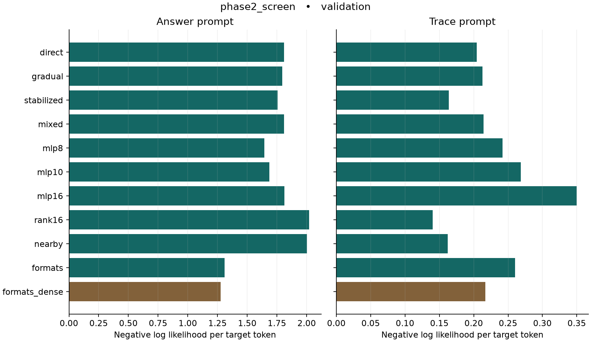
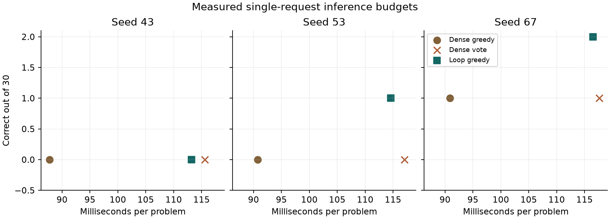

# Phase 2 results

The development criterion selected **direct K=2 with mixed answer and trace supervision**. The confirmatory runs use seeds 43, 53 and 67 with 84 data-matched updates per model. Each time-matched dense run continued until it reached its paired loop’s measured update time. The research question is whether shared recurrent depth improves exact answers, likelihood or quality for the compute spent after matched adaptation.

Fresh in-distribution traced accuracy averaged **45.9% dense and 40.0% loop**. The loop-minus-dense difference was -5.9 percentage points, paired 95% interval [-14.1, +2.2].

Out-of-distribution traced accuracy averaged **32.6% dense and 23.7% loop**. The loop-minus-dense difference was -8.9 percentage points, paired 95% interval [-16.3, -2.2].

## Setup

Apple M3 Pro, 14 GPU cores, 18 GiB unified memory. MLX 0.32.4 and MLX-LM 0.32.2. All forwards, gradients and optimizer updates used Metal. The official Qwen3.5-0.8B-Base revision was `dc7cdfe2ee4154fa7e30f5b51ca41bfa40174e68`. Its text model has 752,393,024 original parameters. Every additional layer execution uses the original module and per-site cache. [Architecture and data audit](PHASE2_ARCHITECTURE.md)

The corpus contains 24,000 training problems, 450 development problems and two disjoint 300-problem ID/OOD splits. Training on every example once would supply 100,453 answer-only labels or 1,784,049 trace labels. The confirmatory protocol scores the first 150 stratified problems per split for NLL, 90 for direct answers and 45 for traced answers. The trace cap is 128 output tokens. Prose NLL uses the same 48 independent paragraphs for all confirmatory arms. [Data manifest](measurements/phase2/data-manifest.json)

## Development and design selection

The historical 200-update dense/loop result was 61/50 correct and the 1,000-update result was 65/59 correct, each on 110 older questions. V2 has different tasks, prompts and golds. The first V2 experiment exposed each model to the same 288 problems. Answer-only supervision scored 1,220 targets and trace supervision scored 21,834. [Historical results](RESULTS.md) · [V2 Stage A table](measurements/phase2/phase2_direct/comparison.md)

The short screens held the update count at 24. Placement used only compatible MLP projections to keep parameter counts identical across different hybrid spans. Model selection used development answer-only NLL. Each candidate competed on the same examples. [Complete screen](measurements/phase2/phase2_screen/comparison.md) · [Frozen policy](../experiments/phase2_selection.json)



| Policy | Trainable | K=2 updates | Alpha at last update | Maximum preclip norm | Update seconds |
|---|---|---|---|---|---|
| direct | 1336320 | 24 | — | 2.87 | 24.8 |
| gradual | 1336320 | 19 | — | 2.63 | 23.4 |
| stabilized | 1336321 | 24 | 0.10004 | 2.14 | 24.8 |
| mixed | 1336320 | 21 | — | 2.87 | 24.0 |
| mlp8 | 663552 | 24 | — | 5.68 | 25.8 |
| mlp10 | 663552 | 24 | — | 2.33 | 22.8 |
| mlp16 | 663552 | 24 | — | 1.25 | 19.2 |
| rank16 | 2672640 | 24 | — | 4.14 | 24.9 |
| nearby | 2271232 | 24 | — | 3.46 | 27.4 |
| formats | 1336320 | 24 | — | 3.84 | 23.5 |
| formats_dense | 1336320 | 0 | — | 2.87 | 17.3 |

## Frozen ID and OOD comparisons

| Split | Prompt | Control | Dense accuracy mean ± SD | Loop accuracy mean ± SD | Loop − dense, paired 95% CI (pp) |
|---|---|---|---|---|---|
| test | answer | dense | 3.7% ± 1.7% | 2.2% ± 2.2% | -1.5 [-5.2, +2.2] |
| test | answer | time | 3.7% ± 2.3% | 2.2% ± 2.2% | -1.5 [-6.3, +3.0] |
| test | trace | dense | 45.9% ± 3.4% | 40.0% ± 2.2% | -5.9 [-14.1, +2.2] |
| test | trace | time | 49.6% ± 3.4% | 40.0% ± 2.2% | -9.6 [-19.3, -0.7] |
| ood | answer | dense | 2.6% ± 1.7% | 2.2% ± 1.1% | -0.4 [-4.4, +3.3] |
| ood | answer | time | 2.6% ± 1.7% | 2.2% ± 1.1% | -0.4 [-4.4, +3.7] |
| ood | trace | dense | 32.6% ± 1.3% | 23.7% ± 3.4% | -8.9 [-16.3, -2.2] |
| ood | trace | time | 31.9% ± 1.3% | 23.7% ± 3.4% | -8.1 [-16.3, -1.5] |

SD is across three training runs. Intervals jointly resample seeds and category-stratified items, with the same item resample for every seed and model. Three seeds and shared procedural templates limit precision. Per-seed wins/losses, exact McNemar probabilities, difficulty and reasoning-depth breakdowns accompany the per-example completions. [Paired statistics](measurements/phase2/phase2_confirm/paired.json) · [Per-model scores](measurements/phase2/phase2_confirm/comparison.md)

## Compute and retention

The original model's general-language NLL on the final prose slice was 3.7062. The projection-work estimate counts two FLOPs per multiply-add for executed backbone and adapter linear projections and the selected-token vocabulary head. GDN state updates, attention products, backward, optimizer and checkpoint recomputation contribute additional work. Time matching uses synchronized full training updates including those operations. Driver utilization samples describe the whole GPU.

| Seed / arm | Updates | Targets | Inputs | Update s | Input tok/s | MLX GiB | Forward projection TFLOPs | Prose NLL (Δ base) |
|---|---|---|---|---|---|---|---|---|
| 43_dense | 84 | 13730 | 31373 | 59.1 | 531 | 4.76 | 51.2 | 3.730 (+0.024) |
| 43_loop | 84 | 13730 | 31373 | 80.9 | 388 | 4.77 | 62.2 | 3.860 (+0.154) |
| 43_time | 116 | 18125 | 42464 | 81.0 | 524 | 4.79 | 69.7 | 3.736 (+0.030) |
| 53_dense | 84 | 12694 | 31256 | 59.2 | 528 | 4.79 | 51.1 | 3.736 (+0.030) |
| 53_loop | 84 | 12694 | 31256 | 81.3 | 384 | 4.80 | 62.2 | 3.869 (+0.163) |
| 53_time | 117 | 17801 | 43477 | 82.2 | 529 | 4.82 | 70.8 | 3.739 (+0.033) |
| 67_dense | 84 | 14917 | 33762 | 61.8 | 546 | 4.84 | 53.7 | 3.731 (+0.025) |
| 67_loop | 84 | 14917 | 33762 | 84.9 | 397 | 4.85 | 65.2 | 3.861 (+0.155) |
| 67_time | 115 | 20228 | 46231 | 85.2 | 543 | 4.84 | 74.0 | 3.729 (+0.022) |

For the sequential inference control, the dense model first answers each of 30 fixed cases greedily. It spends remaining elapsed time on two temperature-0.7 candidates per case in predetermined order. Plurality prefers the greedy answer in a tie. The last pair can overshoot the budget. A dense run whose greedy time already exceeds the loop budget receives zero extra candidates.

| Seed | Loop s | Dense greedy s | Dense vote s | Extra pairs | Correct loop/greedy/vote |
|---|---|---|---|---|---|
| 43 | 3.40 | 2.63 | 3.47 | 4 | 0/0/0 |
| 53 | 3.44 | 2.72 | 3.51 | 5 | 1/0/0 |
| 67 | 3.50 | 2.73 | 3.53 | 5 | 2/1/1 |



## External transfer and depth

| Seed 43 arm | Dataset | Correct / n | Answer NLL |
|---|---|---|---|
| p2_confirm_43_dense | gsm | 2/90 | 1.646 |
| p2_confirm_43_dense | math500 | 3/60 | 1.777 |
| p2_confirm_43_loop | gsm | 1/90 | 1.849 |
| p2_confirm_43_loop | math500 | 3/60 | 1.824 |

External scores use raw answer prompts and bounded greedy decoding. MATH uses a fixed scalar-answer, non-diagram subset and GSM8K uses the publisher's test split. These are exploratory transfer measurements.

| K | Effective layers | Development correct / 30 | Answer NLL | Decode tok/s after 512-position prefill |
|---|---|---|---|---|
| 1 | 24 | 1 | 1.223 | 55.7 |
| 2 | 30 | 0 | 1.199 | 45.6 |
| 3 | 36 | 0 | 1.252 | 38.7 |

K=3 is a depth extrapolation. All three depths above use the same seed-43 checkpoint.

## Numerical and performance diagnostics

| Training positions | Batch | Checkpoint | Median s/update | MAD s | Input tok/s | Peak MLX GiB | RSS GiB | Available system GiB |
|---|---|---|---|---|---|---|---|---|
| 128 | 1 | True | 0.272 | 0.006 | 471 | 2.19 | 1.79 | 5.83 |
| 128 | 2 | True | 0.486 | 0.003 | 527 | 2.81 | 1.87 | 6.17 |
| 128 | 4 | True | 0.946 | 0.013 | 541 | 4.24 | 1.82 | 6.21 |
| 128 | 4 | False | 0.814 | 0.026 | 629 | 5.92 | 1.85 | 6.58 |
| 256 | 1 | True | 0.487 | 0.000 | 525 | 2.79 | 1.98 | 6.77 |
| 256 | 2 | True | 0.941 | 0.004 | 544 | 4.21 | 2.02 | 6.65 |
| 512 | 1 | True | 0.947 | 0.000 | 540 | 4.18 | 2.07 | 6.51 |
| 512 | 1 | False | 0.800 | 0.001 | 640 | 5.90 | 2.01 | 6.96 |

The repeated 24-update native run used the same seed and ordering. Its trained LoRA B factors differed by 2.66% relative RMS. The two trace NLLs were 0.2044 and 0.2045. Correct answer counts were 2 and 2 of 60. [Native precision and cache audit](PHASE2_OPTIMIZATIONS.md)

| Unadapted span / depth | Development answer NLL | Prose NLL | Mean last-pass cosine | Mean relative hidden change |
|---|---|---|---|---|
| 10/1 | 1.888 | 3.586 | 0.577 | 1.332 |
| 8/2 | 1.811 | 3.675 | 0.913 | 0.488 |
| 10/2 | 2.057 | 3.713 | 0.924 | 0.597 |
| 16/2 | 1.918 | 3.765 | 0.954 | 0.659 |

The separate input-anchor ablation trained a scalar mixing the original block input into the next block application. Alpha moved from 0.900 to 0.89998. K=1 parity was exact and K=2 cached versus uncached logit RMS was 1.70%. This arm was outside confirmatory selection. [Matched development comparison](measurements/phase2/phase2_anchor/comparison.md)

### Alternate answer representations

| Seed 43 arm | Numerically correct / 45 | Requested representation / 45 | Canonical response NLL |
|---|---|---|---|
| p2_confirm_43_dense | 0 | 26 | 1.556 |
| p2_confirm_43_loop | 0 | 22 | 1.509 |

The same OOD questions alternate fixed decimal, fraction and scientific-notation requests. Compliance and numerical accuracy are counted independently.

### Gate sensitivity and padding

| Passes | Interpolation alpha | Dev answer NLL | Dev trace NLL |
|---|---|---|---|
| 1 | 0.10004 | 1.7901 | 0.1637 |
| 2 | 0.00000 | 1.7901 | 0.1637 |
| 2 | 0.10004 | 1.7787 | 0.1644 |
| 2 | 0.50000 | 1.7645 | 0.1885 |
| 2 | 1.00000 | 1.8145 | 0.2806 |
| 3 | 0.10004 | 1.7687 | 0.1673 |

| Full training epoch | Padding without buckets | Padding with buckets | Instances too long at 64 | Instances too long at 128 |
|---|---|---|---|---|
| answer_only | 26.6% | 9.5% | 4782 | 0 |
| verified_traces | 18.4% | 2.3% | 23991 | 15438 |
| mixed_answer_and_traces | 36.0% | 29.1% | 14229 | 7723 |

The padding comparison traverses the same complete corpus. Projection FLOP estimates and device-wide utilization samples are archived for each measured study arm. All data-matched confirmatory runs had zero length exclusions at the 256-position cap.

## Export parity

| Seed 43 form | Answer NLL | Correct / 30 | Prose NLL | Token top-1 divergence | Greedy text divergence |
|---|---|---|---|---|---|
| adapter | 1.2145 | 0 | 3.7401 | 0.0% | 0.0% |
| stock | 1.2130 | 0 | 3.7385 | 4.8% | 30.0% |
| fp32 | 1.2109 | 0 | 3.7382 | 3.2% | 33.3% |

Both BF16 fusions include the recurrent loader, tokenizer and provenance. Clean subprocesses checked their merged logits. Adapter inference preserves the original unfused computation. The seed-43 data-matched pair is stored under `adapters/p2_confirm_43_{dense,loop}`. Timestamped local training generations under `checkpoints/` include AdamW state.

| Seed 43 form | Trace NLL | Trace correct / 30 | Changed traced strings vs adapter |
|---|---|---|---|
| adapter | 0.0944 | 11 | 0 |
| stock | 0.0945 | 11 | 5 |
| fp32 | 0.0944 | 11 | 6 |

## Interpretation and next experiment

This local conversion learned to emit useful derivations, but the selected recurrent model lost traced accuracy on the harder distribution, spent more time per matched training example and increased general-language NLL. Dense models used the matched update-time budget for additional training exposure. The short answer-only protocol yielded few correct answers for any arm. Lower teacher-forced trace loss can reward predictable scaffolding even on a problem the model ultimately answers incorrectly.

The next larger experiment should test output interpolation on the selected mixed supervision, with the same dense control and a K=1 bypass of each trained loop. On the trace-only screen, interpolation improved trace NLL and prose retention over direct recurrence. The learned scalar stayed close to its initial 0.1, and its K=1 bypass gave essentially the same development trace NLL. A matched, three-seed gate/bypass comparison tests whether a second pass actually earns its cost.

These are short LoRA runs on one Mac, with 336 examples per data-matched seed. Both response protocols draw from five generated task families. The held-out novel measures one prose domain. External transfer and export checks use one seed. Original trainer states record their launch revision. Some early runs started during implementation, so that revision alone does not identify every working-tree edit. The archived configurations, manifests, curves, weights and result hashes preserve the measured runs. Later workers also record a package source digest.

## Reproduction

Run from a fresh checkout on an arm64 Mac with MLX Metal.

```sh
uv sync --locked --group figures
.venv/bin/python -m loopqwen download
scripts/run_phase2.sh
.venv/bin/python -m loopqwen compare --experiment phase2_confirm
.venv/bin/python -m loopqwen generate --checkpoint adapters/p2_confirm_43_loop --prompt 'Evaluate ((8 + 4) * 3 - 5).
Show your steps. End with Final answer: <number>.
Solution:' --max-tokens 96
```

The seed-43 recurrent adapter generated the following continuation for this command. [Recorded tokens and timing](measurements/phase2/example.json)

```text
8 + 4 = 12
12 * 3 = 36
36 - 5 = 31
Final answer: 31
```
