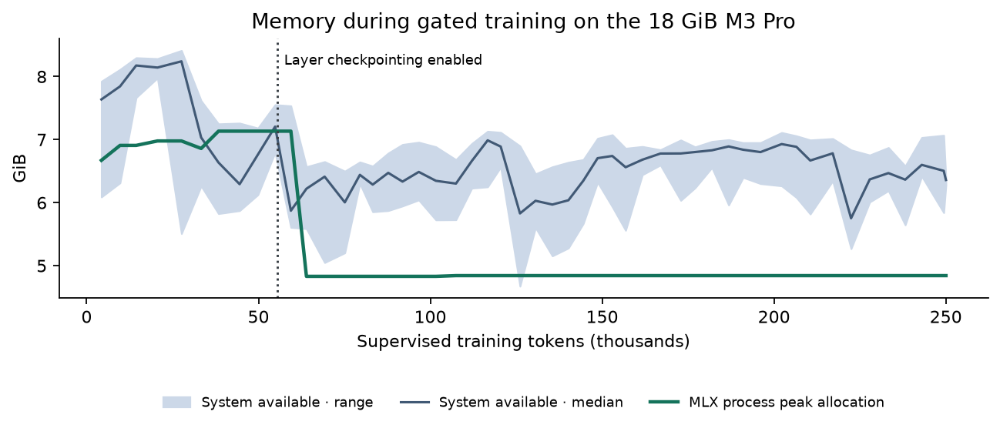

# Phase 3 Metal measurements

Apple M3 Pro, 14 GPU cores, 18 GiB unified memory. MLX 0.32.4 and MLX-LM 0.32.2. The training path uses the previously validated native GDN backward, BF16 activations and selected-position full-vocabulary cross-entropy. No new kernel was required.

## Real training updates

B4, rank 8, layers 10–15, 256-position ceiling. Timing includes evaluated forward, gradients, clipping and AdamW. Data scheduling, validation and checkpoint serialization are outside the update timer. Peak allocation covers training and validation since the last reset.

| Arm | Updates | Update s | Median [p10,p90] s | Inputs/s | Positions/s | Targets/s | Updates/s | s/M targets | Padding | Peak GiB | Peak RSS GiB | Min available GiB | Swap change GiB |
|---|---|---|---|---|---|---|---|---|---|---|---|---|---|
| dense | 629 | 298.6 | 0.433 [0.211,0.766] | 793 | 831 | 335 | 2.11 | 2984 | 4.6% | 6.53 | 1.95 | 4.52 | +0.14 |
| direct | 629 | 416.1 | 0.616 [0.289,1.091] | 569 | 597 | 240 | 1.51 | 4158 | 4.6% | 7.13 | 1.95 | 5.49 | -0.07 |
| learn1 | 629 | 455.6 | 0.690 [0.312,1.214] | 520 | 545 | 220 | 1.38 | 4553 | 4.6% | 7.13 | 1.95 | 5.05 | +0.07 |

## Checkpoint policy screen

Twelve updates per profile. The initial profiles include startup in the aggregate rate. Ordering changes which examples occur in the first twelve updates. The three protocol-ordered checkpointing profiles share the exact cohort.

| Configuration | Targets | Targets/s | Padding | Peak GiB |
|---|---|---|---|---|
| matched_instance_order_on | 1582 | 124 | 33.5% | 4.25 |
| protocol_and_length_block | 1649 | 198 | 5.4% | 5.01 |
| protocol_and_length_off | 1649 | 223 | 5.4% | 6.30 |
| protocol_and_length_on | 1649 | 194 | 5.4% | 4.21 |

A second benchmark fixes all 80 real examples and both warmup batches. Each arm performs 20 timed updates after the warmup. Reordering into length groups changes update boundaries. The position cap splits individual microbatches and normalizes by the same four examples’ total contributing tokens.

| Policy | Microbatch cap | Targets/s | Useful inputs/s | Median update s | Padding | Peak GiB |
|---|---|---|---|---|---|---|
| matched_instance_order | none | 195.3 | 445.2 | 0.847 | 27.2% | 7.09 |
| protocol_and_length | 360 | 264.4 | 602.8 | 0.733 | 1.7% | 4.69 |
| protocol_and_length | none | 260.6 | 594.0 | 0.722 | 3.3% | 6.89 |

## Numerical diagnostics and deployment

Historical K=1 relative RMS was 0. Alpha zero was exact in the native check. Gated full versus chunked relative RMS was 0.01903 and maximum padded versus single-request RMS was 0.01672. Both optimizer groups restored at step 1605. Native GDN backward can exhibit atomic-reduction order differences.

FP32 adapter fusion into BF16 changed verification-prompt logits by 1.41% relative RMS. The merged model reloaded in an isolated Python process. On 30 traced items, K=2 strings differed on 4 items. The unmerged adapter remains the research reference.

Run-level logs include actual post-update MLX active, cached and peak bytes, process RSS, system availability, swap, gradient norms and group rates. An increase in occupied swap alone cannot establish active thrashing.

## Sustained gated run

The first 325 gated updates used no activation checkpointing. Repeated transient macOS warnings around 2 GiB available prompted a controlled stop at 55,470 targets. The new immutable generation hard-links the same adapter weights and AdamW state. The remaining updates recomputed layer activations. Swap occupancy was approximately 1.86 GiB at the transition. The cohort and optimization schedule are identical across arms. The measured gated cost includes both execution policies.

| Checkpointing | Updates | Targets | Update seconds | Targets/s | Peak GiB |
|---|---|---|---|---|---|
| True | 304 | 44598 | 233.8 | 190.8 | 4.83 |
| False | 325 | 55470 | 221.8 | 250.1 | 7.13 |

## 100K to 250K continuation

Each point summarizes 32 consecutive optimizer updates. The band spans post-update system availability. MLX peaks include earlier work in the same worker session. Availability can change while other applications use the Mac.

| Arm | Additional updates | Additional targets | Update seconds | Targets/s |
|---|---|---|---|---|
| dense | 976 | 149963 | 551.4 | 272.0 |
| learn1 | 976 | 149963 | 750.8 | 199.7 |

## Traced inference costs

Sixty traced V2 development requests were split into two counterbalanced halves. Each arm warmed up on a separate short generation. Batch-one request time and batched throughput are reported separately. Times charge every executed lane through the final decode step.

| Arm / batch | Correct | Total s | Requests/s | Useful output tokens/s | Median batch TTFT s | Median batch duration s |
|---|---|---|---|---|---|---|
| dense/1 | 36 | 76.95 | 0.78 | 57.7 | 0.0335 | 1.332 |
| dense/8 | 36 | 15.84 | 3.79 | 280.2 | 0.1875 | 2.012 |
| gated/1 | 36 | 97.10 | 0.62 | 45.8 | 0.0436 | 1.685 |
| gated/8 | 37 | 19.95 | 3.01 | 222.8 | 0.2614 | 2.543 |
| bypass/1 | 35 | 75.22 | 0.80 | 59.1 | 0.0329 | 1.335 |
| bypass/8 | 34 | 15.46 | 3.88 | 287.7 | 0.1814 | 1.997 |

Dense numerical plurality scored 36/60 in 98.3 seconds against a gated batch-one budget of 97.1 seconds. Additional candidates are charged in complete pairs. Selection uses numeric votes with greedy-first ties.

## Active-lane filtering

On four FP32 continuation steps the largest filtered versus full-batch relative RMS was 0. The BF16 timing comparison used 30 identical prompts in counterbalanced order. Primary cohort scoring used fixed lanes.

| Compaction | Seconds | Lane positions | Answers | Changed strings vs first run |
|---|---|---|---|---|
| False | 10.05 | 4840 | 19 | 0 |
| True | 10.16 | 4293 | 19 | 2 |
| True | 9.83 | 4293 | 19 | 2 |
| False | 10.21 | 4840 | 19 | 0 |

## Exact vocabulary-loss timing

Four real traces produced input shape [4, 204] and 402 selected targets. Each method used the same initial model and optimizer, one warmup and four timed updates. Hidden-gradient comparisons isolate projection error from GDN reduction order.

| Head | Setup s | Warmup s | Median update s | Timed range s | Peak GiB | Loss abs. error | Hidden gradient rel. RMS |
|---|---|---|---|---|---|---|---|
| full | 0.113 | 1.498 | 1.470 | 1.468–1.473 | 4.78 | 0 | 0 |
| chunk32 | 0.230 | 1.615 | 1.590 | 1.588–1.599 | 4.78 | 0 | 0 |
| recomputed | 0.327 | 1.724 | 1.685 | 1.683–1.687 | 4.78 | 0 | 0 |
| compiled | 0.121 | 1.552 | 1.529 | 1.504–1.532 | 4.78 | 0 | 0 |

## Adapter and merged task performance

| Format | K | Correct / 30 | Trace NLL | Language NLL |
|---|---|---|---|---|
| adapter | 1 | 18 | 0.06684 | 3.60181 |
| adapter | 2 | 19 | 0.06585 | 3.60374 |
| merged | 1 | 18 | 0.06712 | 3.60130 |
| merged | 2 | 19 | 0.06610 | 3.60332 |

## Promoted 250K deployment

FP32 fusion followed by BF16 storage yielded verification-prompt relative RMS 1.60%. K=2 generation changed on 5/30 prompts and K=1 on 3/30.

| Format | Depth | Correct / 30 | Trace NLL | Language NLL |
|---|---|---|---|---|
| adapter | 1 | 17 | 0.06103 | 3.60249 |
| adapter | 2 | 18 | 0.06055 | 3.60322 |
| merged | 1 | 17 | 0.06123 | 3.60206 |
| merged | 2 | 18 | 0.06074 | 3.60435 |
