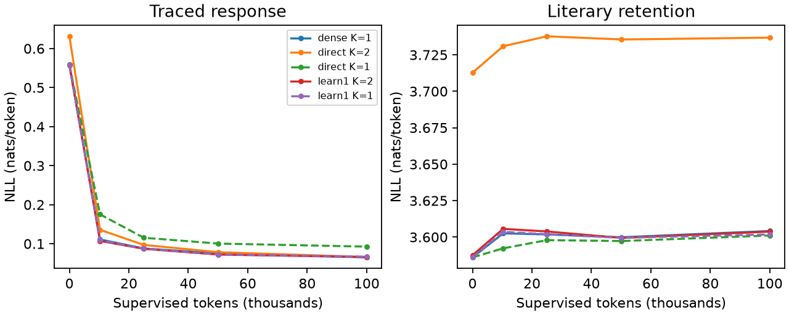

# Phase 3 results

One development seed tested whether a near-identity second block application could earn its extra cost after substantially more supervised training. The comparison starts from Qwen/Qwen3.5-0.8B-Base revision `dc7cdfe2ee4154fa7e30f5b51ca41bfa40174e68`. All three 100K arms used native Metal, BF16, 752,393,024 shared pretrained text parameters and 1,336,320 adapter parameters. The learned gate adds one scalar. [Registration](PHASE3_PLAN.md)

The dense, direct and learn1 arms reached 100,068 supervised tokens at update 629. Each consumed 236,835 useful input tokens and 2,516 distinct problems, with 1242 answer and 1274 trace responses. The realized target partition was 44,580 formatting, 47,515 intermediate, 5,457 final and 2,516 EOS tokens. The Phase 2 confirmatory arms saw 336 examples. The development examples, decoding cap and scoring protocol differ between studies.

## Gate learning and model selection

LR 0.001 and 0.01 both updated the gate. Their eight-update trace NLLs were 0.422311 and 0.422493. The registered tie breakers selected learn1 at 25K. This selection used development data.

| Arm | Execution | Answers | Certificates | Capped | Final NLL | Trace NLL | Prose NLL | Greedy seconds |
|---|---|---|---|---|---|---|---|---|
| dense | trained | 28/60 | 25 | 0 | 0.00012 | 0.0820 | 3.6361 | 14.8 |
| direct | trained | 23/60 | 22 | 1 | 0.00057 | 0.0957 | 3.7673 | 20.7 |
| direct | bypass | 21/60 | 19 | 1 | 0.00035 | 0.1120 | 3.6335 | 19.4 |
| fixed | trained | 27/60 | 25 | 0 | 0.00014 | 0.0825 | 3.6384 | 18.0 |
| fixed | bypass | 27/60 | 25 | 0 | 0.00015 | 0.0829 | 3.6364 | 13.9 |
| learn1 | trained | 30/60 | 27 | 0 | 0.00013 | 0.0814 | 3.6385 | 17.7 |
| learn1 | bypass | 29/60 | 26 | 0 | 0.00013 | 0.0816 | 3.6366 | 14.6 |

## Main development comparison

| Arm | Execution | Answers | Certificates | Capped | Final NLL | Trace NLL | Prose NLL | Greedy seconds |
|---|---|---|---|---|---|---|---|---|
| dense | trained | 36/60 | 34 | 0 | 0.00001 | 0.0603 | 3.6378 | 15.3 |
| direct | trained | 30/60 | 28 | 0 | 0.00002 | 0.0631 | 3.7682 | 19.1 |
| direct | bypass | 26/60 | 22 | 0 | 0.00004 | 0.0835 | 3.6388 | 16.1 |
| learn1 | trained | 36/60 | 35 | 0 | 0.00001 | 0.0605 | 3.6369 | 18.8 |
| learn1 | bypass | 35/60 | 34 | 0 | 0.00001 | 0.0606 | 3.6352 | 15.4 |
| learn1 | alpha0 | 35/60 | 34 | 0 | 0.00001 | 0.0606 | 3.6352 | 18.8 |
| learn1 | alpha0.05 | 36/60 | 34 | 0 | 0.00001 | 0.0604 | 3.6358 | 18.7 |
| learn1 | alpha0.10 | 38/60 | 36 | 0 | 0.00001 | 0.0606 | 3.6363 | 19.1 |

Final NLL here conditions on the correct intermediate trace. V2 traces generally repeat the answer from the preceding intermediate line. The answer-only NLL below scores the response directly after the problem.

| Arm | K | V2 answer-only NLL | V3 OOD answer-only NLL | V3 retention NLL |
|---|---|---|---|---|
| base | 1 | 1.8903 | 2.0176 | 2.9828 |
| dense | 1 | 0.9918 | 1.2553 | 3.0089 |
| direct | 1 | 1.1293 | 1.3507 | 3.0050 |
| direct | 2 | 1.0603 | 1.4141 | 3.1592 |
| learn1 | 1 | 0.9920 | 1.2575 | 3.0076 |
| learn1 | 2 | 1.0118 | 1.2606 | 3.0101 |

Paired differences below compare the trained execution with the named comparator. Bootstrap intervals reflect item variability within this development cohort. Training-seed uncertainty remains unmeasured.

| Pair | Fixed | Broken | Difference (pp) | Item 95% interval (pp) | Exact McNemar p |
|---|---|---|---|---|---|
| direct-dense | 1 | 7 | -10.0 | [-18.3, -1.7] | 0.070 |
| direct-bypass | 7 | 3 | 6.7 | [-3.3, 16.7] | 0.344 |
| learn1-dense | 2 | 2 | 0.0 | [-6.7, 6.7] | 1.000 |
| learn1-bypass | 2 | 1 | 1.7 | [-3.3, 8.3] | 1.000 |

## Fresh development examples

These larger sets include genuinely branching DAGs. The independent retention evaluation covers five documents. The sealed confirmation splits remain available.

| Development split | Arm/K | Answers | Certificates | Capped | Final NLL | Seconds |
|---|---|---|---|---|---|---|
| development | dense/trained | 59/150 | 49 | 0 | 0.0000 | 42.0 |
| development | direct/trained | 51/150 | 42 | 1 | 0.0002 | 49.8 |
| development | direct/bypass | 46/150 | 38 | 2 | 0.0000 | 47.7 |
| development | learn1/trained | 56/150 | 49 | 0 | 0.0000 | 49.3 |
| development | learn1/bypass | 54/150 | 48 | 0 | 0.0000 | 47.7 |
| development_ood | dense/trained | 46/150 | 38 | 1 | 0.0001 | 58.7 |
| development_ood | direct/trained | 36/150 | 30 | 3 | 0.0002 | 61.7 |
| development_ood | direct/bypass | 37/150 | 31 | 3 | 0.0001 | 54.9 |
| development_ood | learn1/trained | 47/150 | 39 | 1 | 0.0001 | 59.3 |
| development_ood | learn1/bypass | 43/150 | 38 | 2 | 0.0001 | 48.4 |

## Learning curves

## Promotion decision

The preregistered 100K promotion rule passed. Selected K=2 scored 36/60, its own bypass scored 35/60 and dense scored 36/60. The selected-minus-dense literary NLL difference was -0.0010. These are exploratory measurements.

[Training, memory and deployment measurements](PHASE3_OPTIMIZATIONS.md) · [Run identifiers and artifacts](EXPERIMENT_REGISTRY.md)

## Effective gate trajectory

The initial alpha was 0.10 and its sigmoid logit was −2.19722. Each listed gradient is token-normalized before joint clipping. Delta is the logit change after the actual AdamW update.

| Step | Targets | Alpha | Logit | Gate gradient | Logit delta | Gate LR | Adapter LR |
|---|---|---|---|---|---|---|---|
| 67 | 10299 | 0.100065 | -2.19651 | -0.000403 | -4.41e-05 | 0.001 | 0.0001 |
| 148 | 25026 | 0.099453 | -2.20332 | -8.77e-06 | +0.00011 | 0.001 | 0.0001 |
| 289 | 50138 | 0.099645 | -2.20117 | 0.00187 | -0.000245 | 0.001 | 0.0001 |
| 629 | 100068 | 0.098031 | -2.21930 | 0.00014 | -5.36e-05 | 0.001 | 0.0001 |
| 1605 | 250031 | 0.094375 | -2.26134 | -0.000161 | +6.48e-05 | 0.001 | 0.0001 |

## Promoted 250K pair

The two arms continued their original AdamW state on the same planned examples, with per-layer checkpointing throughout the extension. Each reached update 1,605 with 250,031 targets, 597,444 input tokens and 6,420 distinct instances. Fresh development scores below remain single-seed observations.

| Cohort | Arm/execution | Answers | Certificates | Capped | Final-token NLL | Retention NLL | Seconds |
|---|---|---|---|---|---|---|---|
| v2_validation | dense/trained | 35/60 | 32 | 0 | 0.00000 | 3.6394 | 15.8 |
| v2_validation | learn1/trained | 38/60 | 35 | 0 | 0.00000 | 3.6392 | 19.5 |
| v2_validation | learn1/bypass | 36/60 | 35 | 0 | 0.00001 | 3.6377 | 16.1 |
| development | dense/trained | 58/150 | 53 | 5 | 0.00000 | 3.0182 | 44.8 |
| development | learn1/trained | 61/150 | 57 | 0 | 0.00001 | 3.0183 | 49.0 |
| development | learn1/bypass | 61/150 | 56 | 0 | 0.00001 | 3.0161 | 44.7 |
| development_ood | dense/trained | 41/150 | 37 | 6 | 0.00000 | 3.0182 | 52.9 |
| development_ood | learn1/trained | 47/150 | 43 | 0 | 0.00001 | 3.0183 | 59.0 |
| development_ood | learn1/bypass | 47/150 | 44 | 0 | 0.00002 | 3.0161 | 52.7 |

The registered eligibility rule for a three-seed confirmation did not pass. The fresh confirmatory cohorts stay sealed.

| Fresh split | Gated K=2 versus | Fixes | Breaks | Difference (pp) | Paired item 95% (pp) | Exact McNemar p |
|---|---|---|---|---|---|---|
| development | matched dense | 6 | 3 | +2.0 | [-2.0, 6.0] | 0.508 |
| development | same checkpoint K=1 | 1 | 1 | +0.0 | [-2.0, 2.0] | 1.000 |
| development_ood | matched dense | 7 | 1 | +4.0 | [0.7, 8.0] | 0.070 |
| development_ood | same checkpoint K=1 | 1 | 1 | +0.0 | [-2.0, 2.0] | 1.000 |

### Problems changed by the extra pass

| Fresh cohort | Problem ID | Family | K=1 prediction | K=2 prediction | Gold | Effect | K=2 trace verified |
|---|---|---|---|---|---|---|---|
| development | 0dd3b0551f78 | modular | 12 | 13 | 13 | fixed | False |
| development | 8988ee3d35c4 | array | 35 | 51 | 35 | broke | False |
| development_ood | 1cd09ea4e37f | system | 18 | 21 | 21 | fixed | False |
| development_ood | e58aa98cee7e | array | 19 | 32 | 19 | broke | False |

Of the 2 final-answer fixes, 0 also produced a fully verified solution. Of the 2 broken answers, 2 had a fully verified bypass solution. [Reviewed cases and next experiment](PHASE3_PLAN.md)

On both fresh cohorts the learned checkpoint retained its higher observed score over dense when decoded at K=1. The extra pass fixed one bypass error and broke one correct answer on each cohort. The item intervals describe this seed. They cannot estimate variation across independent training runs.

The next experiment should replicate dense training versus gated training with both checkpoints decoded at K=1 across independent seeds on development data. Include a dense arm trained for the same measured time, charging its extra training examples. This isolates the possible training-time benefit at equal deployed depth before committing more inference compute.
