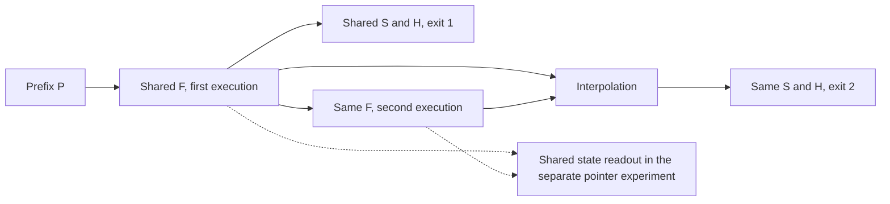

# Phase 4 architecture and objectives

The pinned text decoder has a ten-layer prefix P, a six-layer block F (layers 10–15), an eight-layer suffix S including the final norm, and a tied vocabulary projection H. Phase 4 language models share 752,393,024 pretrained parameters. Block LoRA adds 1,336,320 parameters. The sigmoid gate adds one FP32 logit initialized to log(0.1/0.9). Its AdamW rate is 0.001, compared with 0.0001 for the adapters, following the same five-update warmup.

With p=P(x) and h₁=F(p), direct recurrence uses h₂=F(h₁). Stabilized recurrence uses h₂=h₁+sigmoid(a)(F(h₁)−h₁). Input anchoring uses h₂=F(h₁+β(p−h₁)). A true K=1 request takes the first exit. In cached generation each occurrence of F owns an independent KV cache or GDN state and convolution history. Site caches bind to the model generation, span, gate tensor and override, and fixed attention window. Changing weights through the model update interface invalidates existing requests.

For joint supervision we evaluate H(S(h₁)) and H(S(h₂)) on the same scored positions. One forward executes 38 layers and two selected-position vocabulary projections. Independent forwards execute 54 layers. The loss sums 0.25 CE₁ + 0.75 CE₂ over positions before normalization by the logical batch's target count. The optional token-weighted objective divides by the sum of target weights. Exit targets count each supervised projection. Distinct training targets count each position once. Both gradients reach the shared first pass. Every suffix use receives its own uncached activations.

The label-only objective follows the joint CE construction of Shen et al.; their initial weighting was 0.1/0.9 and their paper also tests distillation. Our registered comparison uses the six-layer span, a learned output interpolation and zero teacher forwards. [One Model, Two Paths, section 3.2](https://arxiv.org/html/2610.33517v1)

The latent experiment reads a state from the final prompt position after each F application using one bias-free 1024-by-8 linear classifier on RMS-normalized activations. Its 8,192 FP32 parameters are required for categorical predictions. The dense comparator passes its single block output through the suffix and learns the same terminal state with the same head size. The probe trains only its head. For n requested hops the installation loss averages CE(R(hⱼ), sⱼ) over j=1…n. The eligible continuation uses only CE(R(hₙ), sₙ); all previous passes remain differentiable. The only recurrent input is the preceding hidden state. Gold states never enter the prompt or the next pass.

Shapiro's retrofit uses separate trainable projections of the prelude and carried state, an identity-biased re-entry gate, and intermediate/outcome-only supervision. We adapt the state-supervision experiment to a categorical readout and a hybrid six-layer Qwen3.5 block. The initial mechanism test uses direct re-entry. [Retrofitting Recurrent Depth, section 3](https://arxiv.org/html/2608.11233v1)

Three further design choices follow the comparison literature. We retain a measured-time dense control alongside the data-matched control. The 100M-token full fine-tune in the Qwen3.5 study is a different scale and adaptation policy. We keep input mixing as an existing architecture option; the two-exit weighted label objective differs from a learned halting distribution with smoothed exit losses. The pointer curriculum limits n early and backpropagates through every executed iteration. [There Is No Free Loop](https://arxiv.org/html/2610.42030v1) · [Closing the Loop](https://arxiv.org/html/2610.00673v1) · [Teaching Pretrained Language Models to Think Deeper](https://arxiv.org/html/2511.07384v1)
