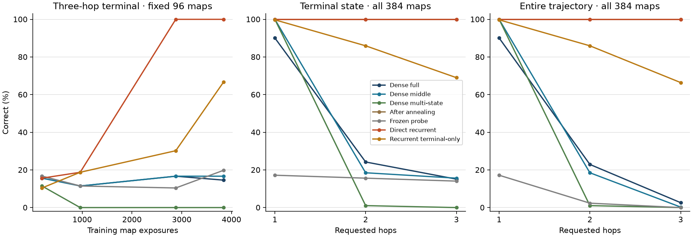
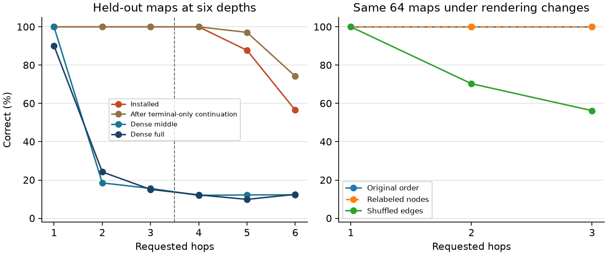

# Can a shared Qwen block advance a pointer?

Seed 109 used the official Qwen3.5-0.8B-Base, revision `dc7cdfe2ee4154fa7e30f5b51ca41bfa40174e68`, on a 14-core M3 Pro with 18 GiB. Phase 4 found that an extra inference pass reduced traced answers from 114 to 112 of 300 on its 250K gated checkpoint. This study supplies an explicit state target at each recurrent application and evaluates on unseen permutations.

The installed checkpoint completed all three states on every one of 384 unseen canonical maps. It also advanced correctly on all 384 at a fourth, unsupervised hop. Shuffling the displayed edges reduced three-hop correctness to 36/64, which closed the confirmatory branch.

## Development results

Each column uses the same 384 maps. A complete trajectory requires all three states. Dense terminal predictions come from three separately depth-conditioned requests. The recurrent prompt contains only the map, initial state and fixed cue.

| Arm | Hop 1 | Hop 2 | Hop 3 | Complete path | Third follows predicted second¹ |
|---|---:|---:|---:|---:|---:|
| Frozen probe | 66 | 60 | 54 | 0 | 47 |
| Dense middle | 384 | 71 | 60 | 1 | 6 |
| Dense full | 346 | 93 | 58 | 10 | 44 |
| Direct recurrent | 384 | 384 | 384 | 384 | 384 |
| Dense multi-state | 384 | 4 | 0 | 0 | 0 |
| Recurrent terminal-only | 383 | 330 | 265 | 255 | 274 |
| After annealing | 384 | 384 | 384 | 384 | 384 |

¹ Counts a prediction equal to the successor of the preceding **predicted** state. Early errors can make this differ from terminal correctness. Gold states never enter the next forward.

The training-fitted start/depth prior scored 53, 62 and 54. The unconditioned eight-way chance rate is 12.5%, and uniform guessing among permissible destinations is 14.29%. Registered installation requires 113, 120 and 113 correct, plus a third readout that improves on the first for three-hop terminal labels.



## Learning curves and optimization

Each early cell gives correct one-, two- and three-hop predictions on the same first 96 development maps. The last column uses that same subset of the full final evaluation.

| Arm | 24 updates | 120 updates | 360 updates | 480 updates |
|---|---:|---:|---:|---:|
| Frozen probe | 9 / 13 / 16 | 22 / 11 / 11 | 7 / 17 / 10 | 17 / 12 / 19 |
| Dense middle | 9 / 7 / 15 | 23 / 11 / 11 | 95 / 25 / 16 | 96 / 13 / 16 |
| Dense full | 9 / 13 / 16 | 18 / 11 / 11 | 11 / 15 / 16 | 85 / 24 / 14 |
| Direct recurrent | 24 / 7 / 15 | 96 / 51 / 18 | 96 / 96 / 96 | 96 / 96 / 96 |
| Dense multi-state | 33 / 10 / 11 | 96 / 0 / 0 | 96 / 0 / 0 | 96 / 0 / 0 |
| Recurrent terminal-only | 9 / 7 / 10 | 96 / 38 / 18 | 96 / 55 / 29 | 96 / 85 / 64 |

Each 480-update arm saw 3,840 distinct maps exactly once in 480 logical updates of eight. The first 48 updates alternated depths one and two. Subsequent updates cycled through one, two and three. AdamW used a constant 0.0003 learning rate, zero weight decay, bias correction and global gradient clipping at one. Adapted controls trained 1,336,320 block adapter weights and 8,192 readout weights. The frozen probe trained the readout alone. The registered bridge would add 24,576 weights. The direct model cleared installation, so the study skipped that branch.

| Arm | State labels | Intermediate labels | Block applications across maps | Update s | Maps/s | State labels/s | Peak MLX GiB |
|---|---:|---:|---:|---:|---:|---:|---:|
| Frozen probe | 3840 | 0 | 3840 | 47.7 | 80.5 | 80.5 | 2.14 |
| Dense middle | 3840 | 0 | 3840 | 107.9 | 35.6 | 35.6 | 3.41 |
| Dense full | 3840 | 0 | 3840 | 198.6 | 19.3 | 19.3 | 4.71 |
| Direct recurrent | 7488 | 3648 | 7488 | 166.3 | 23.1 | 45.0 | 3.91 |
| Dense multi-state | 7488 | 3648 | 3840 | 103.3 | 37.2 | 72.5 | 3.17 |
| Recurrent terminal-only | 3840 | 0 | 7488 | 161.8 | 23.7 | 23.7 | 3.91 |
| After annealing | 640 | 0 | 1288 | 29.5 | 21.7 | 21.7 | 5.32 |

These times count synchronized updates. The archive also records stage log timing boundaries, individual validation passes and checkpoint identities.

## Paired neural controls

Differences below use the same maps for each pair. Intervals resample 384 maps with replacement 10,000 times, seed 109. They quantify item variability in this development seed.

| Pair | Hop | Wins | Losses | Difference in points [95%] | Exact McNemar p |
|---|---:|---:|---:|---:|---:|
| Direct recurrent vs Dense middle | 2 | 313 | 0 | +81.5 [+77.6, +85.4] | 1.2e-94 |
| Direct recurrent vs Dense middle | 3 | 324 | 0 | +84.4 [+80.7, +88.0] | 5.85e-98 |
| Direct recurrent vs Dense full | 2 | 291 | 0 | +75.8 [+71.4, +79.9] | 5.03e-88 |
| Direct recurrent vs Dense full | 3 | 326 | 0 | +84.9 [+81.2, +88.3] | 1.46e-98 |

## Behavioral and causal diagnostics

Each variant uses 64 registered development cases. Exact counts measure correctness. Consistency compares the predicted state with the baseline prediction, translated into the new labels for relabeling. An unchanged wrong answer can be consistent.

| Arm | Request | Exact at hops 1 / 2 / 3 | Consistent at hops 1 / 2 / 3 |
|---|---:|---:|---:|
| Direct recurrent | off_path | 64 / 64 / 64 | 64 / 64 / 64 |
| Direct recurrent | on_path | 64 / 64 / 64 | 64 / 0 / 0 |
| Direct recurrent | order | 64 / 45 / 36 | 64 / 45 / 36 |
| Direct recurrent | original | 64 / 64 / 64 | 64 / 64 / 64 |
| Direct recurrent | other_start | 64 / 64 / 64 | 0 / 0 / 0 |
| Direct recurrent | relabel | 64 / 64 / 64 | 64 / 64 / 64 |
| After annealing | off_path | 64 / 64 / 64 | 64 / 64 / 64 |
| After annealing | on_path | 64 / 64 / 64 | 64 / 0 / 0 |
| After annealing | order | 64 / 45 / 37 | 64 / 45 / 37 |
| After annealing | original | 64 / 64 / 64 | 64 / 64 / 64 |
| After annealing | other_start | 64 / 64 / 64 | 0 / 0 / 0 |
| After annealing | relabel | 64 / 64 / 64 | 64 / 64 / 64 |

The transplant replaces the last prompt-position hidden vector after hop one. The remaining recipient prompt activations and map stay in place. The expected readout after hop two is the recipient map applied to the donor’s first state. All cases and the subset with a correct donor readout are shown. The noise control adds a perturbation with the donor–recipient difference norm.

| Arm | Donor / subset | Cases | Patched target | Unpatched target | Noise target | Original recipient persists |
|---|---:|---:|---:|---:|---:|---:|
| Direct recurrent | cross/all | 64 | 64 | 0 | 0 | 0 |
| Direct recurrent | cross/correct_donor | 64 | 64 | 0 | 0 | 0 |
| Direct recurrent | other_start/all | 64 | 64 | 0 | 0 | 0 |
| Direct recurrent | other_start/correct_donor | 64 | 64 | 0 | 0 | 0 |
| Direct recurrent | same_state/all | 64 | 64 | 64 | 64 | 64 |
| Direct recurrent | same_state/correct_donor | 64 | 64 | 64 | 64 | 64 |
| After annealing | cross/all | 64 | 64 | 0 | 0 | 0 |
| After annealing | cross/correct_donor | 64 | 64 | 0 | 0 | 0 |
| After annealing | other_start/all | 64 | 64 | 0 | 0 | 0 |
| After annealing | other_start/correct_donor | 64 | 64 | 0 | 0 | 0 |
| After annealing | same_state/all | 64 | 64 | 64 | 64 | 64 |
| After annealing | same_state/correct_donor | 64 | 64 | 64 | 64 | 64 |

## Runtime and reproducibility

Both published categorical checkpoints reloaded in independent processes and reproduced every probability across eight maps and three depths exactly. A fresh run on map `5 4 7 6 0 2 1 3` from state zero predicted `5 → 2 → 7`. The 42-test native suite passed. The CPU archive verifier independently rescored all published trajectories and interventions. [Verification record](measurements/phase5-review.json)

The following synchronized timings use the first 32 development maps. Each batch-size/depth combination gets one warmup. Batch-one latency excludes tokenization and setup. The batch-eight column reports throughput for that same fixed workload. The categorical predictions require the published head.

| Arm | Median ms per map at hops 1 / 2 / 3 | Batched maps/s at hops 1 / 2 / 3 |
|---|---:|---:|
| Frozen probe | 19.3 / 19.3 / 19.9 | 93.8 / 92.7 / 92.7 |
| Dense middle | 19.4 / 20.0 / 19.9 | 92.6 / 93.5 / 93.5 |
| Dense full | 27.0 / 27.7 / 28.0 | 63.7 / 64.0 / 64.7 |
| Direct recurrent | 19.1 / 29.1 / 38.3 | 98.3 / 69.6 / 54.0 |
| Dense multi-state | 19.0 / 19.5 / 19.7 | 98.5 / 98.9 / 86.3 |
| Recurrent terminal-only | 21.3 / 32.0 / 40.0 | 93.0 / 65.2 / 52.8 |
| After annealing | 18.9 / 29.6 / 39.2 | 97.2 / 68.7 / 52.3 |

Reproduce from the repository root with the locked environment. The CPU verifier independently reconstructs orbit labels and recomputes predictions from archived probabilities. Native evaluation loads the actual pretrained weights and adapter.

```sh
scripts/run_phase5.sh audit data profile smoke install --seed 109
scripts/run_phase5.sh evaluate diagnostics followup latency donors transfer --seed 109
python3 scripts/verify_phase5_archive.py
.venv/bin/python scripts/phase5_predict.py --arm recurrent --verify
```

[Registration](../experiments/phase5.json) · [Dataset manifest](measurements/phase5/dataset.json) · [Training identities and exposure](measurements/phase5/training.json) · [Checksums](measurements/phase5/checksums.json) · [Hardware screen](PHASE5_OPTIMIZATIONS.md)

## Unseen depths and persistence

All extrapolation uses the same shared weights and depth-independent prompt. The dense controls receive the requested depth. A path wraps once it reaches its start cycle length. The baseline fits start-conditioned frequencies to training maps in the corresponding cycle regime. Each cell is exact predictions / eligible maps.

| Arm | Orbit | Hop 4 | Hop 5 | Hop 6 | Prior correct 4 / 5 / 6 |
|---|---:|---:|---:|---:|---:|
| Dense middle | New states | 46/306 | 34/226 | 24/159 | 47 / 40 / 17 |
| Dense middle | Wrapped | 0/78 | 13/158 | 23/225 | 78 / 80 / 67 |
| Dense full | New states | 42/306 | 28/226 | 25/159 | 47 / 40 / 17 |
| Dense full | Wrapped | 5/78 | 10/158 | 23/225 | 78 / 80 / 67 |
| Direct recurrent | New states | 306/306 | 207/226 | 86/159 | 47 / 40 / 17 |
| Direct recurrent | Wrapped | 78/78 | 130/158 | 131/225 | 78 / 80 / 67 |
| After annealing | New states | 306/306 | 222/226 | 112/159 | 47 / 40 / 17 |
| After annealing | Wrapped | 78/78 | 151/158 | 173/225 | 78 / 80 / 67 |

The 80-update continuation restored both the installed weights and their AdamW moments. It processed 640 additional map exposures from the second epoch with terminal-only loss. The immutable installation checkpoint remains available. Terminal-only training from the original initialization is a separate 480-update control.

| Arm | Terminal at hops 1 / 2 / 3 | All three right | Trainable weights |
|---|---:|---:|---:|
| Direct recurrent | 384 / 384 / 384 | 384 | 1344512 |
| After annealing | 384 / 384 / 384 | 384 | 1344512 |
| Recurrent terminal-only | 383 / 330 / 265 | 255 | 1344512 |
| Dense multi-state | 384 / 4 / 0 | 0 | 1347584 |



## Donor sensitivity

The registered cross-map cases used 64 recipient maps and three distinct donor maps. The supplemental selection uses the same recipients, 64 distinct donors and exactly eight examples of each donor state. Pair selection used only the map constraints and seed.

| Arm | Patched target / 64 | Unpatched target | Noise target | Recipient persists |
|---|---:|---:|---:|---:|
| Direct recurrent | 64 | 0 | 0 | 0 |
| After annealing | 64 | 0 | 0 | 0 |

## Bounded zero-shot transfer

This exploratory check was registered after the canonical pointer result and before transfer scoring. It uses the first 96 development maps rendered as room descriptions. For categorical transfer the recurrent prompt omits the requested hop count. For ordinary generation every arm receives the same requested-hop prompt. A single unrestricted greedy token is scored against the exact tokenizer digit ID. No verbal adaptation was performed.

| Arm | Categorical 1 / 2 / 3 | Greedy digit 1 / 2 / 3 | Same weights K=1 digits | Retention NLL K=1 / K=3 |
|---|---:|---:|---:|---:|
| Untouched Base | — / — / — | 11 / 9 / 15 | — | 2.9346 |
| Dense middle | 17 / 12 / 17 | 17 / 12 / 15 | — | 2.9678 |
| Direct recurrent | 91 / 74 / 69 | 15 / 22 / 42 | 15 / 8 / 1 | 2.9610 / 3.3846 |
| After annealing | 92 / 73 / 67 | 14 / 20 / 38 | 14 / 8 / 1 | 2.9638 / 3.3864 |

The installed checkpoint generated the correct ordinary three-hop token on 42/96 verbal tasks at K=3. Its K=1 bypass scored 1/96, and untouched Base and the matched dense middle control each scored 15/96. This is a narrow transfer benefit accompanied by a prose NLL increase from 2.9610 to 3.3846 when the installed checkpoint runs three passes.

The retention sample contains 20 source-disjoint development chunks and 1,437 scored prose/technical tokens. This is a bounded retention check.

## Interpretation and next experiment

Executing the shared block advanced a state that could be read out at each hop on unseen canonically ordered maps. Both the depth-conditioned dense controls trained on terminal states and the equal-label single-pass control fell short on longer paths. The hidden-vector transplant changed the next answer to the successor under the recipient map. That supports a causal role for information at the readout position. The vector can carry more than the abstract node label.

Display order is a reproducible failure mode. At hops one, two and three, the direct model answered 64, 45 and 36 of 64 shuffled-map cases correctly. Among the 19 two-hop errors, 10 followed the edge in the display slot indexed by the previously predicted node. The strict per-hop 70% invariance criterion failed at hop three. Cross-map and display-order evidence describe different properties. The exploratory phase used one training seed; the 384-map confirmation cohort and the Phase 3 sealed language suites remain unused.

**Next experiment.** Randomize the presentation order of the eight edges during otherwise matched 480-update installation. Keep each map, start, depth, state label, adapter initialization and exposure budget fixed. Score original and shuffled presentations on the same registered development maps and repeat the balanced transplant check. This directly tests the observed failure without adding parameters.
