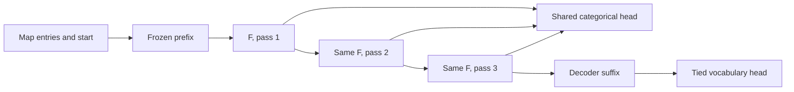
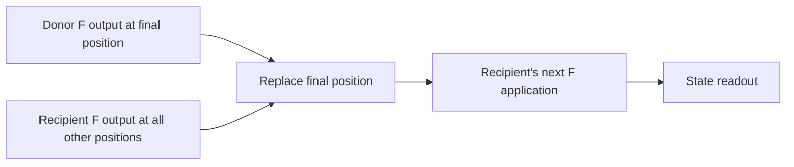

# Shared computation under reordered input

The experiment retains the official BF16 Qwen3.5-0.8B-Base text decoder. Layers 0–9 compute the frozen prefix. Each application of layers 10–15 uses the same pretrained weights and 1,336,320 FP32 trainable LoRA parameters. The direct recurrent arm reads the last real prompt position after each pass through a single 8,192-weight head and averages cross entropy across executed passes within each map. The dense terminal controls receive the requested hop count and read after layer 15 or after the full decoder. The equal-label dense control reads one middle representation with three independent 1024-by-8 heads. Its 1,360,896 trainable parameters include 16,384 additional readout weights compared with the recurrent arm.

The suffix and vocabulary head belong to the language-model pathway. The primary categorical experiment ends at R. State labels enter the loss. Only activations enter the next shared block. A categorical unroll is uncached. The language-model cache still binds a distinct attention/GDN state to each execution site at fixed depth.

The cross-map target is the recipient map applied to the donor's first state. The registered cases include matched-norm noise and the original recipient trajectory. These interventions replace a whole hidden vector. [Mechanism trainer](../loopqwen/training/mechanism.py) · [Interventions](../loopqwen/evaluation/order_diagnostics.py)
