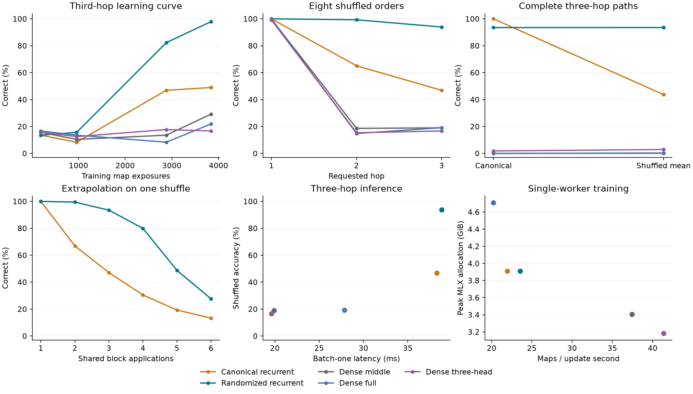

# Phase 6 observed development results

At seed 109 the model trained on randomized edge displays predicted 2,885 of 3,072 third-hop states across eight prespecified shuffles of 384 unseen maps (93.91%). It correctly completed 2,873 three-hop trajectories (93.52%). Its canonical third-hop score was 360/384 (93.75%). The registered canonical floor required 365 correct. Each of the 12 evaluated presentations used the same underlying maps. The number of independent map clusters is 384.

| Presentation | Hop 1 | Hop 2 | Hop 3 | Complete paths |
|---|---:|---:|---:|---:|
| Canonical | 384/384 | 383/384 | 360/384 | 359/384 |
| Reversed | 384/384 | 380/384 | 359/384 | 359/384 |
| Rotation by one | 384/384 | 384/384 | 365/384 | 365/384 |
| Rotation by four | 384/384 | 382/384 | 358/384 | 356/384 |
| Eight shuffles pooled | 3,072/3,072 | 3,050/3,072 | 2,885/3,072 | 2,873/3,072 |

The matched canonical rerun solved every canonical path. Under the same eight shuffles it solved 46.88% of third hops and 43.65% of complete trajectories. Changing only the training renderer gained **47.04 percentage points** on shuffled third hops (paired map-bootstrap 95% interval **43.62 to 50.52 points**). The canonical rerun reproduced the original vulnerability on a larger cohort. The 6.25-point cost on canonical third hops is also material.

The third-hop answer was correct under all twelve orders on 328 maps. Four maps failed under every order. Among 163 third-hop errors on random displays for which the predecessor's source-key successor differed from its display-slot successor, 25 predictions matched the display slot. The model still makes errors specific to presentation. The similar canonical and shuffled averages also point to a third-hop accuracy limit shared across presentations.

All five primary arms completed the registered 480 updates. Every arm saw the same ordered 3,840 maps, with one presentation per training map. The dense terminal controls received 3,840 labels and the intermediate-supervised arms received 7,488. The canonical floor closes promotion. Phase 6 cross-order transplants, terminal-only continuation, additional seeds, confirmation, functional-graph transfer and ordinary vocabulary-head training remain gated. The earlier Phase 5 transplant, verbal and retention measurements concern different weights. [Registration](PHASE6_PLAN.md) · [Mechanism and readouts](PHASE6_ARCHITECTURE.md)

The implementation records installation and promotion decisions separately. One failed required measurement closes the dependent stage while any unmeasured prerequisites retain their pending status. Independent, already-registered primary comparisons finish. This closeout policy applies to future studies. [Research stopping protocol](TRAINING.md#stopping-a-staged-study)

## Matched controls and inference cost

| Arm | Shuffled first hop | Second hop | Third hop | Complete path | K=3 request, median ms |
|---|---:|---:|---:|---:|---:|
| Recurrent, canonical training | 99.97% | 65.10% | 46.88% | 43.65% | 38.26 |
| Recurrent, randomized training | 100.00% | 99.28% | 93.91% | 93.52% | 38.82 |
| Dense middle, terminal label | 99.77% | 18.59% | 18.98% | 0.13% | 19.91 |
| Dense full, terminal label | 99.93% | 14.78% | 19.11% | 0.29% | 27.86 |
| Dense middle, three independent heads | 99.12% | 15.33% | 16.67% | 2.90% | 19.61 |

Latency measures an individual uncached three-hop request at batch one. The dense models execute once and receive the requested depth in the prompt or head selection. The recurrent model executes the shared block three times. The randomized recurrent checkpoint's third-hop advantage over the strongest dense terminal control was **74.80 percentage points** (paired map-bootstrap 95% interval **70.54–78.78**). The full dense arm used 1,344,512 trainable weights and 189.9 update seconds. The stronger three-head control used 1,360,896 weights and the same 7,488 state labels as the recurrent arm. All estimates describe seed 109 and this development distribution.

## How far the transition carries

On random0, the randomized checkpoint scored 307/384, 187/384 and 106/384 at the unseen fourth, fifth and sixth hops. For fresh states those counts were 252/306, 126/226 and 68/159. For paths that had wrapped they were 55/78, 61/158 and 38/225. On canonical displays it scored 301, 187 and 118. At random0 hop six, 109/384 predictions stayed at the preceding predicted state when its correct successor would have moved.

For the 96-map precision diagnostic, moving the shared block to FP32 changed sixth-hop accuracy from 30 to 30 on canonical displays and from 32 to 30 on random0. Giving the sixth application the first pass's context vectors while preserving the latest readout position produced 34 and 31 correct. Resetting only the readout position produced 21 and 20 correct. These limited interventions give little support for rounding alone or degraded map context alone explaining the late errors. On random0, late incorrect novel-state predictions had a smaller average readout update RMS (0.07 versus 0.09) and greater cosine similarity to the preceding state (0.82 versus 0.73). The observations are consistent with some failures to advance. They do not identify a unique internal cause.

The biggest remaining uncertainty is exposure. On the same 96 shuffled maps the randomized third-hop checkpoint scored 13, 15, 79 and 94 at updates 24, 120, 360 and 480. The single additional epoch proposed in the [review handoff](PHASE6_REVIEW.md) would test whether learning continues, while preserving this decision and its sealed cohorts.

## Thinking-enabled one-on-one deployment benchmark

After the categorical promotion decision, a separately registered inference-only benchmark compared the installed K=3 checkpoint with untouched Qwen Base at K=1. It used Qwen's actual chat template with thinking enabled, byte-identical prompt tokens, unrestricted greedy decoding and a 384-token cap. The initial six pairs comprised three shuffled room-navigation questions and three independent procedural development questions. The preregistered floor rule fired.

| Model | Correct final answers | Scorable final answers | Capped | Generated tokens | Total inference seconds | Median request seconds |
|---|---:|---:|---:|---:|---:|---:|
| Untouched Qwen Base, K=1 | 0/6 | 0/6 | 6/6 | 2,304 | 34.61 | 5.73 |
| Trained randomized loop, K=3 | 0/6 | 0/6 | 6/6 | 2,304 | 56.82 | 9.46 |

All twelve generations reached the cap inside the thinking segment. Neither model emitted a final answer. There were zero exclusive wins for either model. The other fourteen planned pairs were skipped, avoiding up to 10,752 more output tokens at this uninformative operating point. These measurements support a latency comparison and leave ordinary answer quality unresolved. A future reasoning benchmark needs a pilot on which Base reliably completes answers under the chosen budget. Full verbal adaptation and a new general-language retention evaluation stayed gated. [Raw answers and scores](measurements/phase6/reasoning-pair) · [Preregistered floor](../experiments/phase6_reasoning_pair.json)

The [release archive](measurements/phase6) contains training histories, the exact schedule, probabilities, orders, CIs, cache benchmark and immutable weight hashes. Generate the detailed per-order calibration, consistency, nonwrapping and wrapped accuracy and latency tables with `python3 scripts/phase6_tables.py`. [Randomized model card](measurements/phase6/randomized/README.md) · [Canonical model card](measurements/phase6/canonical/README.md) · [Verification and review handoff](PHASE6_REVIEW.md)
