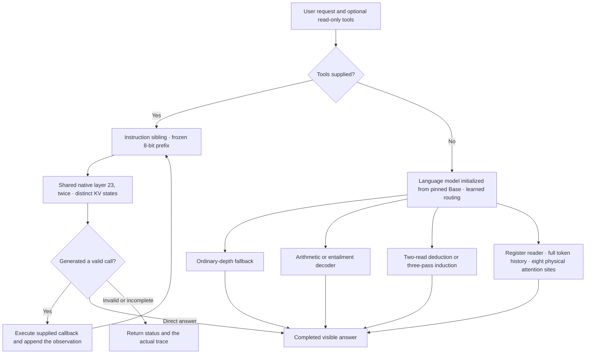
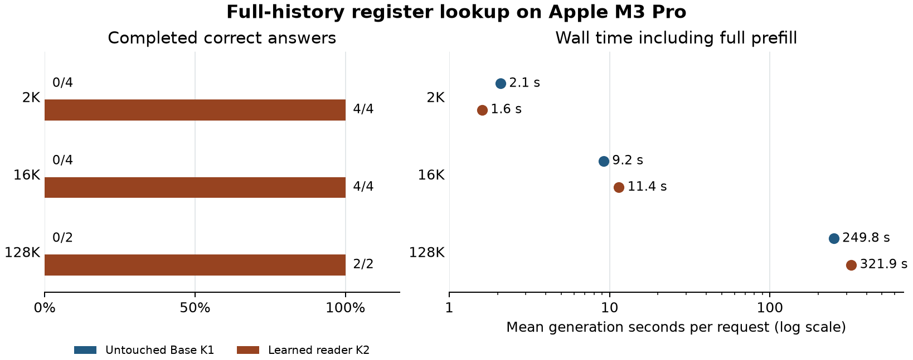

# LoopQwen project review, November 26

The deployment question is whether a person gets more correct, completed answers from the trained decoder than from the pinned Qwen3.5-0.8B-Base, at a measured cost, while retaining ordinary language and useful long context. Establishing that repeating layers deserves credit requires a second comparison with a trained ordinary-depth model. These questions have produced different answers in this repository. [Capability scoreboard](CAPABILITY_SCOREBOARD.md)

Two complete Git trees now provide a field example of useful long context. The same asset changed from 7,039 to 9,552 bytes. An optional two-pass reader generated both numbers after consuming the entire 173K and 191K prompts. It also gave the correct wheel size on a full lockfile, with extra prose. Base missed all three. The numerical result covers two file formats, and the registered exact-response rule leaves the reader opt-in. [Per-document predictions and physical cache receipts](../research/results/document-frequency-reader-01)

Tool use has a different bottleneck. When shown a real calculator receipt, a recurrent reviewer distinguished the correct and incorrect computation on 16/24 held-out questions, against 2/24 for Base. In free dialogue neither system successfully repaired its own initially wrong computation. The candidate lost eight net fresh arithmetic answers. [Supplied receipts, actual actions and free answers](../research/results/observation-review-01)

A new fit produced grounded arithmetic on 12/24 versus 9/24 but lost final-answer accuracy on both fresh arithmetic and the independent DROP corpus. Its apparent two-request service lead of 9/12 versus 2/12 shrank to 11/12 versus 9/12 after fixing how numbers inside quoted resource names were counted. Redundant correct lookups bring Base to 10/12. The original scored traces, retrospective alternatives and complete user exchanges are available together. [Registered primary](../research/results/question-contrast-01) · [Independent service recount](../paper/service-meaning-summary.csv)

Both systems retained the full 158,693-token opening of Hawthorne’s novel across follow-ups. Neither completed either human question. The loop grounded both Hawthorne file answers and neither Piper file answer. Base grounded one on Hawthorne and both on Piper. Six complete requests took 353.20 versus 319.32 seconds. The released tool model missed its book-quality, wall-time, first-token and cold-prefill gates. [Sealed book conversations](../research/results/book-conversation-field-01) · [Calls, returned quantities and latency](../paper/book-conversation-requests.csv)

## What runs in the released assistant



The explicit tool catalog selects the tool backbone. A natural-language request goes through the language policy, which can choose ordinary depth. Consequently a product score can reflect routing, training, quantization or decoding as well as recurrence. For example, the whole novel took the ordinary route, whereas the 131K key-swap used the register reader. All language routes can also stop at the output cap. The public `ask --compare-base` command exposes both systems' answers and actual timings on a caller's own question. [Latest offline release qualification](../research/results/packed-release-retention-03) · [Measured comparisons](../paper/loopqwen.pdf) · [Current research decisions](NEXT_EXPERIMENTS.md)

On a fresh **131,086-token** register and its key swap, the looped model answered **2/2 versus 0/2** for untouched Base. Eight-bit feed-forward and output weights raised its post-first generation rate to **29.27 versus 27.42 tokens/s**. Including both weight conversions, the two requests finished in **167.39 versus 390.86 s** at **3.32 versus 3.78 GiB** peak MLX allocation. Both individual inputs favored the recurrent system on prompt and output rate. The comparison covers one document with two placements of the same queried name. [Sealed predictions and timings](../research/results/register-mixed-weight-full-01) · [Per-request conversion and physical history](../paper/mixed-weight-requests.csv)

## What each phase established

| Evidence | Finding | Consequence for deployment |
|---|---|---|
| Pilot and extended training | With 4,000 matched training examples, the recurrent adapter answered 59/110 procedural questions correctly and its dense twin answered 65. The extra pass fixed four net answers over the same adapter at ordinary depth. | A same-checkpoint depth gain and the best use of the training budget can point to different models. [Extended study](EXTENDED.md) |
| Three-seed Phase 2 | Direct recurrence averaged 23.7% on out-of-distribution traced problems versus 32.6% for matched dense adaptation. The paired interval for the difference was −16.3 to −2.2 percentage points. | Blindly repeating a pretrained span is a poor general default. [Phase 2 results](PHASE2_RESULTS.md) |
| Gated arithmetic, Phases 3 and 4 | Two development seeds supported a small training-time effect. At seed 109, ordinary-depth inference from the recurrently trained checkpoint scored 114/300, its second pass scored 112 and both dense controls scored 108. The second pass cost additional time. | The small development gains missed the registered promotion threshold. A stabilized arithmetic parent is a plausible substrate for a language experiment. [Phase 3](PHASE3_RESULTS.md) · [Phase 4](PHASE4_RESULTS.md) |
| Explicit state supervision, Phases 5–7 | The shared middle layers learned a permutation transition. Randomized presentation and continued training brought third-hop performance to 3,067/3,072 shuffled presentations of 384 maps. Hidden-state transplant controls show a causal role for the carried state. | The operation is real on the covered distribution. Sixth-hop complete paths fell from 190/192 on permutations to 6/192 on arbitrary successor maps. [Mechanism results](PHASE7_RESULTS.md) · [Structural transfer](CAPABILITY_SCOREBOARD.md#zero-shot-structural-transfer) |
| Generated paths and replay | On 96 fresh maps, trained K1 solved 96 complete traces at 198 ms median. Trained K3 solved 95 at 447 ms. Adaptive six-hop data selection won at equal updates and lost to static training at matched time. | Publish generated answers, exact paths and synchronized cost together. Correct intermediate states alone cannot establish a faster or better language model. [Generated paths](CAPABILITY_SCOREBOARD.md#same-requested-trace-fresh-96-map-cohort) · [Adaptive selection](RSI_RESULTS.md) |
| Public language anchors | The earlier verbal checkpoint scored 1/32 versus 2/32 on GSM8K and tied Base on ARC-Easy. Equation-only training later produced 26 completed numeric answers against zero for thinking-enabled Base, with one correct answer. | Training the answer boundary can help completion. Accuracy and independent prose retention determine whether that helps the user. [Public comparison](../research/results/external-anchor-01) · [Equation outputs](../research/results/gsm-equations-01) |

## Why test full history and language adaptation together

The checkpoint supports 262,144 positions in its text configuration. At 131,072 tokens and batch one, its six full-attention sites need 1.50 GiB for BF16 keys and values alone. Repeating layers 10 through 15 once adds two full-attention sites and raises that payload to 2.00 GiB. Both figures exclude model weights, temporary buffers, cache growth and convolutional/DeltaNet state. Changing a context-limit constant would buy no memory. [Pinned Qwen configuration](https://huggingface.co/Qwen/Qwen3.5-0.8B-Base/blob/dc7cdfe2ee4154fa7e30f5b51ca41bfa40174e68/config.json)

RULER evaluates retrieval, multi-hop tracing and aggregation across lengths. Its results motivate measuring full prompt ingestion, retrieval of an early fact, and reasoning over distant evidence independently. The registered ledger probe covers the first two on one item. Its full token stream is archived so the two storage paths and two model depths can be compared exactly. [RULER paper](https://arxiv.org/abs/2404.06654) · [Benchmark implementation](https://github.com/NVIDIA/RULER)

Geiping and colleagues trained a 3.5B recurrent-depth model on 800B tokens and found gains from additional inference computation. LoopQwen adapts six existing layers in a much smaller hybrid decoder. The pretraining result motivates the mechanism, while this repository’s dense twins and same-weight bypasses measure whether the retrofit earns its extra passes. [Recurrent-depth paper](https://arxiv.org/abs/2502.05171) · [Training and inference code](https://github.com/seal-rg/recurrent-pretraining)

GSM8K supplies human-written multistep solutions. The language adaptation uses complete publisher explanations during training, including units and the relationship between quantities, then scores one freely generated first turn. Hsieh and colleagues studied rationales as supervision for smaller models. Their data and multitask method differ from this response-only experiment. [Publisher dataset](https://github.com/openai/grade-school-math) · [Rationale supervision](https://arxiv.org/abs/2305.02301)

## What counts as progress

The primary language pair fixes ordered questions, exact prompt token IDs, the opening thinking marker, greedy generation, output cap and scorer. The newly trained checkpoint is compared with untouched ordinary-depth Base. Accuracy, paired gains and losses, actual generation seconds, produced tokens and retention on 9,328 independent language targets are measured together. The 32 development questions were already used in earlier studies. Improvement there needs a fresh sample for confirmation. Unknown Base pretraining overlap limits any claim of unseen public questions. [Frozen language protocol](../research/experiments/gsm-rationale-01.json) · [Question and training identities](../research/data/gsm-rationale-01.json)

The scored 128K pair uses identical input IDs for both depths with full-history caches at every attention site. The disk-backed implementation writes intermediate activations as BF16 bits, stores each completed site's prefix in its original dtype, and reads the prefix during decode. It trades storage I/O for lower resident cache memory. All model inference and training use native MLX on Metal. The 259-token preflight compares every vocabulary logit across four positions before committing to long prefill. [Full-history protocol](../research/experiments/context-128k-01.json) · [Disk-backed protocol](../research/experiments/context-128k-disk.json)

FlexGen schedules tensor movement among GPU, host and disk for high-throughput batched inference. Here the host and GPU share the same memory, so moving a cache from Metal to a resident CPU array would still consume unified memory. The implementation stores completed KV prefixes on disk and measures the cost of reading them on every decode step at batch one. [FlexGen paper](https://arxiv.org/abs/2303.06865) · [MLX-LM project](https://github.com/ml-explore/mlx-lm)

The fresh panel uses 24 of Scale AI’s 50 publicly released GSM1K examples and 24 SVAMP examples, six per arithmetic operation. The same adapter and scorer face a 1,024-token ceiling. This directly tests whether additional time for Base to finish changes the deployment conclusion. The shorter 256-token comparison is read from the same greedy streams, with its elapsed time measured during generation. The publisher datasets are public, so prior exposure during Qwen pretraining is unknown. [Registered transfer comparison](../research/experiments/rationale-transfer-01.json) · [GSM1K public release](https://github.com/scaleapi/gsm1k_eval) · [SVAMP study](https://aclanthology.org/2021.naacl-main.168/)

## What fits on the 18 GiB M3 Pro

Both resident-cache runs processed the same 131,072 input IDs and generated all 96 allowed output tokens. The target number appeared about 13,100 tokens into the ledger. Both generations were still in the thinking span at the limit and neither contained the target. MLX peak allocations are process measurements. The operating system and filesystem cache also use unified memory. [Prompt, emitted IDs and timings](../research/sessions/2026-11-25/context-128k-01)

| Resident checkpoint | Time to first token | Total time | Prefill tokens/s | Decode tokens/s |
|---|---:|---:|---:|---:|
| Untouched Base K1 | 192.44 s | 195.97 s | 681 | 26.9 |
| Phase 4 arithmetic parent K2 | 261.75 s | 266.53 s | 501 | 19.9 |
| Deployed 32-update rationale K2 | 261.27 s | 262.37 s | 502 | 19.1 |

The actual deployed rationale adapter also consumed every input token. It completed a 22-token answer and returned 13494. The early ledger entry was 965265. This directly establishes capacity on the trained weights and records an incorrect retrieval even when the answer finished within the allowance. [Trained checkpoint at 128K](../research/results/context-rationale-128k)

The original run stopped on a system memory warning after processing 112,768 Base input tokens. After Chrome closed, available memory reached 9.48 GiB. The completed test used the original registration, prompt and allocation guard. The working context limit therefore depends on other applications on this machine. [Initial interruption](../research/results/context-128k-01) · [Recovery record](../research/sessions/2026-11-25/resumption.json)

### Disk-backed memory and speed

| Checkpoint and storage | Peak MLX allocation | Temporary disk | First token | Total for 96 generated tokens | Decode tokens/s |
|---|---:|---:|---:|---:|---:|
| Base K1 resident | 3.78 GiB | 0 | 192.44 s | 195.97 s | 26.9 |
| Base K1 disk-backed | 2.22 GiB | 1.75 GiB | 232.13 s | 248.79 s | 5.7 |
| Phase 4 K2 resident | 4.32 GiB | 0 | 261.75 s | 266.53 s | 19.9 |
| Phase 4 K2 disk-backed | 2.59 GiB | 2.25 GiB | 315.45 s | 338.21 s | 4.2 |

Both measured storage modes produced identical sequences of 96 output IDs at each depth. The disk-backed preflight also produced bit-identical full-vocabulary logits at four positions on a 259-token prompt at both depths. The disk-backed path saves 40% of peak MLX allocation on K2 and takes 27% longer for this complete request. During decode the disk path rereads all stored prefixes for every generated token. The table reports the MLX peak since the start of each study worker, which includes earlier arms and parity checks. Temporary directories are removed when the request exits. [Parity, per-arm timings and outputs](../research/sessions/2026-11-25/context-128k-disk)

### Recount the archived deployments

From the checkout root, these commands use Python's standard library to verify checkpoint identities, exact prompts, emitted first turns, timing aggregates and the registered decisions. Native inference additionally needs the pinned checkpoint and locked Apple Silicon environment.

```sh
python3 scripts/research_registry.py
python3 scripts/research_archive.py gsm-rationale-01 --verify --recovered-session 2026-11-25
python3 scripts/research_archive.py context-128k-01 --verify --recovered-session 2026-11-25
python3 scripts/research_archive.py context-128k-disk --verify --recovered-session 2026-11-25
python3 scripts/research_archive.py context-rationale-128k --verify
python3 scripts/research_archive.py rationale-transfer-01 --verify
python3 scripts/research_archive.py rationale-dense-01 --verify
```

## Which model to use for these word problems

The trained recurrent adapter improved correct first turns under 256 output tokens on all three measured groups. It scored 13/32 on reused GSM8K development questions, 7/24 on fresh public GSM1K and 16/24 on fresh SVAMP. Base scored 1, 1 and 8 respectively. Accuracy at 1,024 tokens favored Base on both fresh sources. The candidate finished all 23 of its correct fresh answers within 167 tokens, and Base first matched that count at token 482. This crossover describes these archived items. Both sources remain frozen against further tuning. [Budget curve and per-source scores](CAPABILITY_SCOREBOARD.md#fresh-word-problems-at-two-output-budgets)

Most of the short-budget development gain is also available at ordinary depth. The dense twin trained on the identical 128 publisher explanations delivered 10/32 correct turns in 53.56 s, versus 13/32 in 64.64 s for K2. K2 gained six paired answers and lost three, meeting the prespecified two-answer and 1.25× time criteria. The exact two-sided paired p-value is 0.508 on nine discordant items. That modest difference combines training and deployment depth and comes from a single lineage. The V3 retention NLL differed by less than 0.00004 between trained models. [Matched dense evidence](../research/results/rationale-dense-01)

## Follow-up experiments

The longer-budget comparison exposed two separate failure modes. A short, well-formatted calculation could still use the wrong relationship between quantities, and a model could process a long ledger yet return the wrong value. The new language experiment uses fresh publisher solutions and checks the final operation by reversing it with exact rational arithmetic before accepting a training target. This check establishes arithmetic consistency of that operation. Choosing the right operations for the problem is still evaluated by freely generated answers. Cobbe et al. trained a verifier to rank sampled solutions. Here the arithmetic check applies only when constructing the training data, and the generator receives one greedy attempt. [Checked-solution protocol](../research/experiments/checked-rationale-01.json) · [Training Verifiers to Solve Math Word Problems](https://arxiv.org/abs/2110.14168)

The separate retrieval curriculum uses random six-digit values assigned to equally formatted three-word keys. It tests two target positions and whether the request names the key before the records. This makes query placement and document length explicit, both of which matter when interpreting retrieval results. All input positions remain available to the model, and every prompt and answer has a frozen identity. The new ledger distribution differs from the earlier Juniper probe. [Length and placement protocol](../research/experiments/ledger-curriculum-01.json) · [Lost in the Middle](https://arxiv.org/abs/2307.03172) · [RULER](https://arxiv.org/abs/2404.06654)

### Learning which passage to attend to

The ledger adapter's two 16K errors both returned another entry's value. An independent model leaves the arithmetic decoder frozen and trains a passage scorer on raw token embeddings. It compares the final 64 prompt tokens with overlapping 12-token passages and learns from the location of a training value. The scorer receives the token sequence alone at inference. This is related to ColBERT's use of multiple embedding comparisons for passage ranking. Here the selected passage changes a decoder attention mask inside the full prompt. [Registration](../research/experiments/attention-memory-01.json) · [ColBERT](https://arxiv.org/abs/2004.12832)

The last input position and later generated positions can attend more strongly to the selected span. Every earlier position remains in the cache, and the model still generates the number one token at a time. Positions before the final input position retain their normal causal attention. The scorer is inactive below 1,024 prompt tokens. Separate scores record whether the selected span contains the number and whether the model returns it correctly. These can disagree. The evaluation also includes prose with new wording, names differing in one word, per-item timings and an exact short-generation regression check. [Implementation](../loopqwen/attention_memory.py)

The trained reader has 32,929 parameters, about 129 KiB in FP32. All three calibration strengths located the annotated value on 12/12 items. Increasing the gain from 3 to 6 to 9 reduced actual correct answers from 12 to 9 to 4. The lowest gain won the prespecified selection rule. On the independent qualification cohort the decoder then produced 8/8 correct answers, against 0/8 for untouched Base. Total generation took 52.2 s against 45.1 s. This isolated a case where optimizing passage selection alone would have missed an important change in generation quality. [Calibration traces and held-out generations](../research/results/attention-memory-01)

The shared-budget arithmetic study asks whether quick answers leave enough computation for additional independent reasoning attempts. Self-consistency aggregates multiple sampled reasoning paths. Here both models first receive an unrestricted greedy attempt and may spend the remainder of the same 1,024 generated tokens on new attempts. Every attempted token and its generation time are charged. The separate natural reading pilot uses questions written by SQuAD annotators and complete Wikipedia paragraphs from the same article as distractors. It tests transfer away from uniform record keys. [Self-consistency](https://arxiv.org/abs/2203.11171) · [SQuAD](https://aclanthology.org/D16-1264/) · [Public reading protocol](../research/experiments/prose-reading-01.json)

## A controlled change at 128K

The two full-length filing registers each contain 131,078 tokens. The second swaps two equal-length three-word names at roughly 10% and 75% of the document. Every numeric value keeps its original token offset. The unchanged query therefore has a different answer. Both models processed every position and used the same greedy reasoning policy with a 96-token cap. The learned reader produced 245799 and 307755. Untouched Base used all 96 tokens twice without a completed first turn. The reader took 643.73 s across the two documents, compared with 499.67 s for Base. [Paired full-history generations](../research/results/attention-memory-128k)



Both long requests used the disk-backed BF16 cache on the 18 GiB M3 Pro. Peak MLX allocation across the four-run worker was 3.94 GiB. This counter accumulates across requests. The reader used 2.25 GiB of scratch space per request. The measured revision held some completed attention caches until cyclic garbage collection. A subsequent ownership fix releases those allocations as soon as a site retires. The archived latency and peak figures come from the measured revision. On the revised runtime, both full-length passage selections matched. All six final prefill mask rows and all 30 decode masks per document matched the expected full-history values. A disk-backed 16,395-token generation reproduced all 31 resident reference tokens. [Full-context runner](../loopqwen/research/counterfactual_memory.py) · [Cache-lifetime and input-integrity tests](../tests/test_attention_memory.py)

The reader's transfer limit appeared on 12 public Wikipedia reading requests with same-article distractors. It selected the annotated source paragraph three times and scored 2/12 exact, with 0.408 mean token F1. Base scored 4/12 and 0.511. The model's successful long-register behavior can coexist with weaker natural reading on shorter inputs. The general-purpose reference remains untouched Base. [Frozen free-text outputs](../research/results/prose-reading-01)

## Deployment decision

For a short word-problem budget, the original K2 arithmetic adapter beat Base on fresh questions from both public sources. Direct supervision with inverse checks and preference training on its own sampled solutions reproduced the short-budget direction on two further disjoint panels. None of these studies established a general longer-budget advantage. Even when both systems could spend their common 1,024-token allowance on independent attempts, Base solved 25/32 and K2 solved 20/32. K2 was faster in all these language comparisons. [Word-problem scoreboard](CAPABILITY_SCOREBOARD.md#shared-1024-token-reasoning-budget)

For uniform record lookup, the released reader preserves the original short decoder and handles the measured 131,078-token intervention on a single Apple Silicon machine. Natural reading remains a separate limitation. The dense-control evidence attributes much of the arithmetic gain to adaptation, and the direct reader-versus-Base pair measures the entire trained system. Establishing a contribution from recurrent depth to long retrieval would require the same passage training on a matched dense decoder. [Matched arithmetic control](../research/results/rationale-dense-01) · [Reader evaluation](../research/results/attention-memory-01)

## Full-budget reasoning after all-layer adaptation

Expanding the six-layer adapter to all 24 layers and training on 1,152 new arithmetic worked solutions and 384 annotated reading answers preserved the short-budget arithmetic advantage. At 256 tokens, the recurrent model solved 21/48 and Base solved 7/48. At 1,024 tokens, Base reached 33/48, while the trained model stayed at 21/48. The trained model gained three answers and lost fifteen on the paired comparison (two-sided exact p = 0.00754). It used 85.13 seconds versus 342.78 for Base. Its raw language NLL was 3.0028 versus 2.9827. This checkpoint failed the preregistered full-budget accuracy criterion on both sources. [Registration](../research/experiments/all-layer-reasoning-01.json) · [Outputs, weights and decision](../research/results/all-layer-reasoning-01)

The timing records suggested a different training target. On this 48-question panel, Base gained 26 correct answers between tokens 256 and 1,024. The all-layer adapter gained zero. The recurrent-deliberation trial keeps Base's actual early token stream and trains the repeated span to continue authentic partial solutions. The switch changes the active model depth and charges a second prefill over all preceding tokens. At inference every output token comes from the active model's unrestricted greedy vocabulary head. Research on test-time thinking budgets motivated checking the timing of a transition as well as its final accuracy. [Frozen architecture and training protocol](../research/experiments/recurrent-deliberation-01.json) · [Muennighoff et al., 2025](https://arxiv.org/abs/2501.19393)

A reading of every completed Base response that the strict numeric scorer rejected makes the full-budget gap larger. Five such responses gave the correct answer in prose or angle brackets, including “Zachary did 7 push-ups.” Accepting those five visible answers gives 38/48 for Base and 21/48 for the trained adapter. Seven unfinished Base turns still receive zero credit. The registered 33/48 result stands under its original rule. [Complete per-item records](../research/results/all-layer-reasoning-01/base.json.gz) · [Frozen scorer](../loopqwen/evaluation/answers.py)

## What the remaining reasoning budget buys

Six archived 1,024-token arithmetic comparisons contain 240 ordinary-depth Base responses. The table counts turns still generating inside the thinking block at each boundary. A completed turn includes both the thinking close and the first turn boundary. The content column also credits an unambiguous correct visible answer written in prose. Each row follows the same outputs to the same 1,024-token endpoint.

| Tokens already generated | Still thinking | Subsequently completed | Subsequently correct, strict | Subsequently correct, content |
|---:|---:|---:|---:|---:|
| 512 | 78 | 39 | 20 | 24 |
| 768 | 48 | 9 | 3 | 3 |
| 896 | 42 | 4 | 1 | 1 |

Switching at 512 puts more correct Base answers at risk. Switching at 896 leaves only 128 generated tokens to finish the reasoning and give a visible answer. These retrospective counts motivated a fresh late-switch pilot. They measure Base's exposure to the intervention and cannot predict how many of those cases a trained model can repair. [Blind answer annotations](measurements/answer-audits) · [Late-switch registration and original checkpoint](../research/experiments/late-recurrent-exit-01.json)

## Training a recurrent exit on the reasoning lengths it will see

The retained training set contained 64 real ordinary-depth reasoning traces. Twenty-three still had an open thinking block at their original 512-token cap. The new study resumes those traces from their original tokens on the pinned Base, up to 832 tokens. It trains the K2 decoder on the gold visible answer and fits a linear correction to the logit of the existing thinking-close token. The readout sees the recurrent hidden state and the number of tokens generated. Earlier positions in the same traces supply negative examples. The full vocabulary competes at each step. The decoder switches only when a thinking turn is still open after 704 generated tokens, and reprocessing the whole prefix counts toward latency. A related early-exit study estimates answer confidence at intermediate prefixes. Here the stopping signal is fitted to native recurrent states and judged by its effect on completed answer accuracy. [Registration](../research/experiments/learned-exit-01.json) · [Wang et al. on early exiting](https://arxiv.org/abs/2509.26522)

The prior projected student imported a median of 9.6% of the squared post-training update across 186 mapped projections. An independent study tests the complete update to all internal decoder tensors, including attention, recurrent parameters and normalizations. Its vocabulary embedding and output projection stay pinned to Base. It selects one interpolation coefficient using separate training passages, then optimizes the recurrent model on arithmetic solutions, reading answers and ordinary text. The frozen 1,024-token comparison measures whether the retained information actually improves answers. [Full-rank registration](../research/experiments/fullrank-reasoning-01.json) · [Task arithmetic](https://arxiv.org/abs/2212.04089) · [Official donor checkpoint](https://huggingface.co/Qwen/Qwen3.5-0.8B/tree/2fc06364715b967f1860aea9cf38778875588b17)

The entailment comparison tests a different part of ordinary language reasoning. Each human-written premise is paired with three distinct claims. One follows from the premise, one contradicts it and one is left open. Training uses explanations from e-SNLI, labeled MultiNLI training pairs and raw language anchors. The held-out panel includes captions and MultiNLI genres absent from its training split. A separate native three-word probability probe measures whether the trained decoder assigns its highest score to the right relation before producing a formatted response. The randomization test swaps models for each complete premise group to preserve dependence among the three claims. [Frozen panel and decision rule](../research/experiments/entailment-triplets-01.json) · [e-SNLI](https://github.com/OanaMariaCamburu/e-SNLI) · [MultiNLI](https://cims.nyu.edu/~sbowman/multinli/)

## What changed the measured language results

A full-rank mixture of 318 internal tensors with the official post-trained sibling lowered raw validation NLL from 2.98266 to 2.91114. On the same 32 new arithmetic prompts and 1,024-token budget, the mixture answered 12 correctly against Base's 19. It used 120.17 versus 277.14 generation seconds. Those accuracy and loss results motivated measuring completed task answers independently from prose perplexity. [Full-rank comparison](../research/results/fullrank-reasoning-01)

The learned-exit checkpoint produced six additional correct arithmetic answers across two disjoint panels, with zero lost correct answers. All six common prefixes had already calculated the correct number before token 704. The improvement is attributable at the system level to selecting and delivering a correct answer within the common allowance. Generation, including the second prefill, used 8.4% less total time. Its raw K2 language loss rose by 0.01272. The integrated model uses ordinary depth for raw text and reproduced Base's language loss across all 120 retention passages. [Shared-prefix examples](measurements/answer-audits/learned-exit-gains.json) · [Two independently scored arithmetic panels](measurements/answer-audits/learned-exit-pooled.json) · [Integrated deployment](../research/results/conditional-depth-01)

For natural inference, presenting three hypotheses per premise exposes a distinct failure mode. Predicting the same relation for an entire premise can produce one correct answer but cannot solve the triplet. The trained model completed 15/40 whole triplets versus 3/40 for Base. Independent blind scoring across 120 human-written claims yielded 85 versus 66. A separate common-prefix language-model probability comparison yielded 88 versus 54, with identical alternatives for both models. These tests establish a scoped gain in semantic judgment as well as shorter output. Public natural-language inference collections can contain hypothesis-only cues. The design controls the premise across each group, while reliance on cues in the hypotheses remains possible. [Frozen primary comparison](../research/results/entailment-triplets-01) · [Independent wording and premise replication](../research/results/entailment-triplets-confirm-01) · [Gururangan et al. on annotation artifacts](https://arxiv.org/abs/1803.02324) · [McCoy et al. on inference heuristics](https://aclanthology.org/P19-1334/)

The initial shared deployment improved three of five workload totals, reproduced every ordinary-route response token and had a small number of per-item regressions under blind review. It consumed a complete 131,081-token history, but an unequal-width key swap shifted intervening tokens and invalidated that specific fixed-position comparison. The independent archive verifier caught the construction error. New full-context panels must satisfy the actual token permutation before inference begins. [Blind mixed-workload annotations](measurements/answer-audits/conditional-depth-01.json) · [Invalidated intervention and original native observations](../research/results/conditional-depth-128k)

The 80-request integrated comparison includes eight distinct held-out reading articles. After earlier studies used 44 of the 48 SQuAD validation titles, only four unused titles remained. The first frozen panel contained 76 requests and was closed before inference. Its replacement preserves all 76 in the same relative order and adds four opening questions from QuAC validation, with the named Wikipedia article and section supplied. Only first-turn questions with a majority of answerable human annotations qualify. QuAC is distributed by Choi et al. under CC BY-SA 4.0; the selected source passages and answers retain that license. The public comparison uses its own extractive scorer. [Frozen 80-request design](../research/experiments/conditional-language-02.json) · [Publisher data, attribution and license](https://quac.ai/) · [CC BY-SA 4.0](https://creativecommons.org/licenses/by-sa/4.0/)

## What the additional pass learns

The controlled reading experiment gives the first pass a specific job. It learns which fact identifies the person in the question. A second learned read follows that fact to the relevant rule. Running the same Qwen layers on the sentence states supplies the intermediate representation. The reader marginalizes over every possible first fact. Only training receives the supporting-fact labels. The full-prompt Qwen decoder supplies the ordinary next-token logits throughout generation. This builds on multi-hop memory networks, which previously demonstrated that extra learned reads can help on these toy tasks. [End-To-End Memory Networks](https://arxiv.org/abs/1503.08895) · [Original bAbI task descriptions](https://github.com/facebookarchive/bAbI-tasks) · [Frozen data mirror](https://github.com/harvardnlp/MemN2N/tree/f32f9531ba4230a7accc06b467c53d4d7322f62f/babi_data/en)

A second engineering question is whether repeating pretrained transformer computation adds value after allowing the same number of evidence reads. The study includes a span-only bypass for this question. The native induction experiment isolates the repetition further by feeding compressed sentence tokens to the same Qwen self-attention and MLP layer. Related recurrent-depth architectures train the representation and update together, sometimes from pretraining scale. The paired studies test how far those results carry over to this pinned Qwen checkpoint. [Universal Transformers](https://research.google/pubs/universal-transformers/) · [Scaling up Test-Time Compute with Latent Reasoning](https://arxiv.org/abs/2502.05171)

The QASC comparison uses human-authored science questions, the two supplied support sentences and four distractors. Both models receive all six sentences. Its answer choices and fact order are permuted before training and testing. A further open-domain retrieval system would have to find its evidence in the original 17-million-sentence corpus. [QASC project and dataset](https://github.com/allenai/qasc)


For three-fact induction, the native-layer experiment places each premise in a stable compressed token and lets a single question state attend to all premises on every application of Qwen layer 15. During training, different pairs of native attention heads receive the publisher's support indices in order. Only the original prompt, the learned tensors and the iteration number enter inference. The one-pass control can use the same head pairs at its sole exit. This comparison tests the role of sequential communication at equal trainable size. Research on looped transformers has found similar depth effects on controlled multi-hop tasks. CLUTRR offers a separate test with family relations and human-paraphrased sentence templates. [Reasoning with Latent Thoughts](https://proceedings.iclr.cc/paper_files/paper/2025/file/2676109d49d1eb26d6bc584a8f556305-Paper-Conference.pdf) · [CLUTRR benchmark](https://aclanthology.org/D19-1458/) · [Native layer registration](../research/experiments/native-induction-anchored-01.json)
