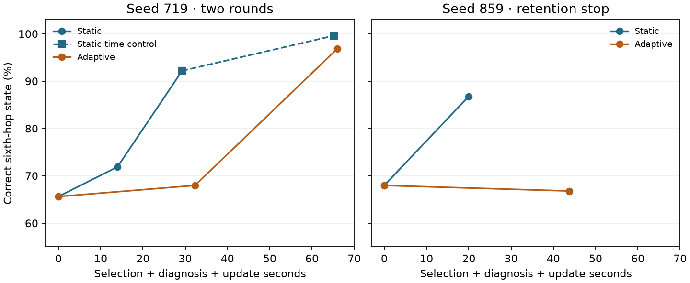

# Does model-directed selection improve the next generation?

On curriculum seed 719, learner-directed selection bought **12 more correct sixth-hop predictions at equal training exposure**. Spending the diagnostic time on additional static training bought **seven more correct predictions than the adaptive model**. All three measurements use the same 128 development maps, each in two shuffled orders, and the same six recurrent applications. The installed Phase 7 R624 weights started both branches. This experiment tests an outer curriculum loop on a fixed eight-state operation.

## Capability scoreboard, seed 719

Each score is out of 256 presentations. Compute columns show incremental seconds at that generation. An update includes synchronized forward, gradient, clipping and AdamW work.

| Model | Hop 3 | Hop 6 | Complete six-hop path | Hop-6 NLL | Candidate diagnosis s | Update s | Validation s |
|---|---:|---:|---:|---:|---:|---:|---:|
| Parent R624 | 255 | 168 | 157 | 1.370 | 0 | 0 | 8.60 |
| Static round 1 | 253 | 184 | 178 | 1.154 | 0 | 13.95 | 8.57 |
| Adaptive round 1 | 252 | 174 | 164 | 1.234 | 17.37 | 14.94 | 8.84 |
| Static round 2 | 256 | 236 | 233 | 0.291 | 0 | 15.32 | 9.25 |
| Adaptive round 2 | 256 | 248 | 248 | 0.098 | 18.21 | 15.52 | 9.36 |
| Static with adaptive time allowance | 256 | 255 | 255 | 0.011 | 0 | 35.95 extra¹ | See timing record |

¹ Includes a negligible extra selection cost. Cumulative diagnosis, selection and update costs were 29.28 s for the original static branch, 66.04 s for adaptive and 65.24 s for the extended static branch. The time control used 30 extra updates and 240 additional maps. It finished with 62 cumulative updates and 496 map exposures, versus 32 updates and 256 exposures for the original pair. Each original branch received 1,264 supervised state labels. Extended static received 2,464. Validation and the shared parent run are charged separately. The primary study took 142.75 s wall time, the time-control follow-up 48.31 s including restore and validation. [Matched study](measurements/rsi1/decision.json) · [Measured-time control](measurements/rsi_time1/decision.json)

The paired sixth-hop difference was **+4.69 percentage points** for adaptive versus static, with a 95% map-cluster bootstrap interval of **+0.39 to +9.38**. Third-hop accuracy held at 256/256. Both registered equal-update criteria passed. Under matched time, the direction reversed to **−2.73 points**. The modest per-round differences and their uncertainty apply to this development cohort. Single-seed item intervals cannot establish general training-seed superiority.



## What changed between generations

Both branches trained identical rank-eight shared-block LoRA and the eight-way readout, 1,344,512 trainable weights. Both started with fresh identical AdamW settings and passed their first-generation optimizer moments into generation two. Updates cycled through four, five and six hops with all executed states supervised. Batch size was eight and the physical cap was 84 positions. Each generation executed 213,024 decoder-layer positions. Peak MLX allocation during updates was 2.40 GiB. No vocabulary-head training took place in these branches.

The generator created two 256-map training-only pools and a separate fixed development cohort. Map identity exclusions include earlier pointer, counterfactual, sealed, V4 and Phase 7 comparison maps. All seeds preserve eight start nodes and two cycle-length groups. Each branch took eight of sixteen candidates in each of the sixteen strata. Generation and independent gold verification together took 0.19 s on seed 719. Ranking took under 0.002 s per branch per round. The recorded diagnosis time includes batched inference, probability extraction and verifying predicted trajectories on both displays. The native graph shared its prefix and six successive state reads across exits.

Static selection used prespecified salted hashes. Adaptive selection queried the current generation, categorized failures, uncertain successes and mastered cases, and filled shortages according to the fixed registration. Round two diagnosed a new pool with the actual first-round adaptive weights. Neither branch selected from development outcomes. The archive preserves both probability distributions, entropy, correct-state probabilities, first incorrect pass, order, selected IDs and the parent/child and optimizer hashes. [Selector registration](../experiments/rsi_pilot.json) · [Generation archives](measurements/rsi1)

The selected curricula genuinely differed. Static and adaptive shared 61 of their 128 maps in round one and 64 in round two. The narrow failure bucket supplied just one example in each adaptive round. The prescribed fallback therefore added boundary and mastered cases. Both rounds' priorities and selections can be independently reconstructed. [Per-candidate rank audit](measurements/rsi1-ranks.json.gz)

## Independent curriculum seed and stopping decision

Seed 859 began from the same R624 weights with a fresh disjoint pool, development cohort and curriculum order. The measured training seed here controls exposure and selection. The experiment does not replicate the earlier installation of R624.

| Seed 859 | Hop 3 / 256 | Hop 6 / 256 | Complete paths / 256 | Hop-6 NLL | Diagnosis s | Update s | Validation s |
|---|---:|---:|---:|---:|---:|---:|---:|
| Parent | 255 | 174 | 163 | 1.200 | 0 | 0 | 12.57 |
| Static round 1 | 249 | 222 | 219 | 0.583 | 0 | 19.91 | 12.25 |
| Adaptive round 1 | 250 | 171 | 157 | 1.171 | 23.92 | 19.83 | 11.32 |
| Static round 2 | — | — | — | — | — | — | — |
| Adaptive round 2 | — | — | — | — | — | — | — |

The static branch lost six of 256 third-hop predictions, a **2.34-point** regression against its parent. The registered maximum was two points for either arm after the matched round. Both round-two jobs closed. The first-round adaptive-minus-static sixth-hop difference was **−19.92 points** (95% paired map-bootstrap interval **−28.52 to −11.33**). The two-round seed-719 advantage remains unreplicated. Seed 859 consumed 102.45 seconds wall time. Neither sealed cohort entered scoring or training.

Across seed 719's time-matched comparison, adaptive-minus-static was **−2.73 points**, with a paired map-bootstrap interval of **−5.47 to −0.39**. These results close the registered distillation gate. No teacher distribution, learner-created environment, learned challenger or distillation result is claimed. [Replication decision](measurements/rsi2/decision.json) · [Frozen follow-up rules](../experiments/rsi_followup.json)

## Verified self-training yield

The Phase 7 vocabulary checkpoint was asked for all three visited room numbers on one line. It sampled twice per training map with temperature 0.65 and a 32-token limit. The run generated 100 actual tokens across 32 lines in 7.27 s of study time. Seventeen samples had a correct final number, 31 omitted the steps, and one had an unsupported format. **Zero of 16 maps** produced a fully verified trajectory. The registered floor was eight. The self-generated and gold-data SFT branches closed with zero updates. Every raw response remains archived, including the failures. This is a limit of the tested wording and checkpoint. It also explains why a successful single-digit vocabulary task provides insufficient evidence of trace generation. [Yield registration](../experiments/rsi_verified_trace.json) · [Sampled output](measurements/rsi_trace1/candidates.json.gz)

## Reproduction

On the locked native Mac environment with pinned model assets and the historic map namespaces populated, run:

```sh
scripts/run_rsi.sh pilot
scripts/run_rsi.sh time-control
scripts/run_rsi.sh replicate
scripts/run_rsi.sh traces
python3 scripts/rsi_archive.py
python3 scripts/rsi_followup_audit.py
```

Use `python3 scripts/rsi_archive.py --archive docs/measurements/rsi2` for the replication archive. To run a released checkpoint, use `.venv/bin/python scripts/rsi_predict.py --archive docs/measurements/rsi_time1 --arm time --map 5 4 7 6 0 2 1 3 --start 0 --depth 6`. The measured-time static checkpoint was strongest on the original fresh six-hop cohort. No language transfer or base-model retention was measured for those categorical generations.

**Next experiment:** fine-tune the existing Phase 7 verbal checkpoint on short, gold-verified three-transition responses and compare it directly against its unchanged parent on fresh verbal maps. Register completed, fully verified trajectory rate and time per request before training. This addresses the observed failure to emit intermediate states before spending more compute on self-training.

The measured-time control uses the original local static optimizer generation. Each published trainable artifact includes its small state readout and adapters. The full base and AdamW moments stay out of Git. The CPU audit independently traverses maps and scores the stored model predictions. Training and generation require actual MLX/Metal.

The isolated native regression suite passed all 52 tests. In seven fresh processes the released RSI generations reproduced 336 categorical argmax predictions with zero maximum probability difference on the checked records. The six-hop time-control example above produced `[5, 2, 7, 3, 6, 1]`.
